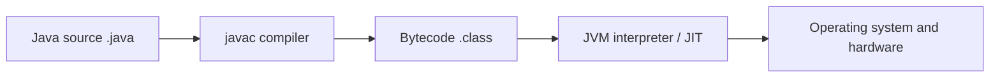

<a id="top"></a>
<div align="center">

# ☕ Java Interview Questions and Answers — Top 100 (2026)

### Core Java • OOP • Collections • Streams • Concurrency • JVM • Coding Problems

**100 clear explanations · 100 practical Java snippets · 100 interview tips**

**By Code with Jamshed**


**[Start Learning](#table-of-contents) · [Coding Round](#section-10) · [Revision Plan](#14-day-interview-plan) · [Official Resources](#official-resources)**

</div>

---

> [!IMPORTANT]
> **Target audience:** Java freshers, college students and developers preparing for Java, Spring Boot and full-stack interviews. Every answer is explained in **simple Indian English**, with a practical code example and a useful interview tip.
>
> **Version:** Core snippets use widely supported Java APIs, while examples marked **Java 21+** need at least JDK 21. As of October 2026, **JDK 27** is the newest feature release and **JDK 25** is the latest LTS release (see [Oracle downloads](https://www.oracle.com/java/technologies/downloads/)). **JDK 21 or 25** is a comfortable choice for practicing this guide.

## Why this guide is different

| What you get | How it helps |
|:---|:---|
| 🧠 **Simple explanations** | Quick interview-ready answers without unnecessary jargon |
| 💻 **Practical Java code** | Understand ideas by running and changing examples |
| 🎯 **Interview tip with every Q** | Remember the tricky follow-up question |
| 🧭 **100 direct question links** | Jump to a topic quickly instead of endless scrolling |
| 🧪 **10 solved coding exercises** | Practice time/space complexity and common patterns |
| 📚 **Modern Java notes** | Covers Java 8+ concepts and Java 21 permanent features |

## How to run code snippets

Install a JDK and check your version:

```bash
java -version
javac -version
jshell
```

Most snippets are **small independent JShell-style learning examples**, so you can paste them into [JShell](https://docs.oracle.com/en/java/javase/25/jshell/introduction-jshell.html) one at a time. Some examples declare classes or static helper methods; in a normal `.java` file, place them inside a class as appropriate. The `module-info.java` example is a file, not a JShell snippet. Include relevant standard-library imports when writing `.java` files, for example:

```java
import java.util.*;
import java.util.stream.*;
import java.util.concurrent.*;
import java.util.concurrent.atomic.*;
import java.nio.file.*;
import java.nio.charset.*;
import java.io.*;
import java.time.*;
import java.time.temporal.*;
import java.net.URI;
import java.net.http.*;
import java.lang.ref.*;
```

> [!NOTE]
> Each example is intended to demonstrate one idea. Outputs are shown only when predictable; OS-, JVM- or timing-dependent examples may differ. Do not paste all snippets into one file without resolving repeated class and variable names.

## Java execution in one picture



---

## Table of contents

| # | Topic | Questions | What you will learn |
|---:|---|:---:|---|
| 01 | [**Java Fundamentals**](#section-1) | Q01–Q10 | JVM, JDK, types, equality, modifiers and pass-by-value |
| 02 | [**OOP and Object Design**](#section-2) | Q11–Q20 | Classes, abstraction, inheritance, interfaces, polymorphism |
| 03 | [**Strings and Arrays**](#section-3) | Q21–Q30 | Immutability, String pool, arrays and common patterns |
| 04 | [**Collections and Generics**](#section-4) | Q31–Q40 | List, Set, Map, sorting, iterators and wildcards |
| 05 | [**Exceptions, File I/O and Immutability**](#section-5) | Q41–Q50 | Exceptions, resource management and safe classes |
| 06 | [**Lambdas, Streams and Optional**](#section-6) | Q51–Q60 | Functional programming and data transformations |
| 07 | [**Multithreading and Concurrency**](#section-7) | Q61–Q70 | Threads, locks, executors and virtual threads |
| 08 | [**JVM, Garbage Collection and Performance**](#section-8) | Q71–Q80 | Memory, GC, JIT and diagnostics |
| 09 | [**Modern Java Features**](#section-9) | Q81–Q90 | Records, sealed classes, switch, HTTP client and modules |
| 10 | [**Java Coding Interview Problems**](#section-10) | Q91–Q100 | 10 DSA challenges with tested patterns |

<details>
<summary><strong>🔎 Show all 100 question links</strong></summary>

**01. Java Fundamentals**

- [Q001. What is Java? How are JDK, JRE and JVM different?](#q001)
- [Q002. Why is Java called platform-independent?](#q002)
- [Q003. What is the difference between primitive and reference types?](#q003)
- [Q004. What are wrapper classes and autoboxing?](#q004)
- [Q005. What is the difference between == and equals()?](#q005)
- [Q006. What are default values of instance variables and local variables?](#q006)
- [Q007. What does static mean in Java?](#q007)
- [Q008. What is the final keyword?](#q008)
- [Q009. What are public, private, protected and package-private?](#q009)
- [Q010. Is Java pass-by-value or pass-by-reference?](#q010)

**02. OOP and Object Design**

- [Q011. What are a class, object and constructor?](#q011)
- [Q012. What are the four pillars of OOP?](#q012)
- [Q013. What is encapsulation?](#q013)
- [Q014. What is method overloading versus overriding?](#q014)
- [Q015. What is inheritance? When is composition better?](#q015)
- [Q016. Abstract class versus interface: what is the difference?](#q016)
- [Q017. What are this() and super()?](#q017)
- [Q018. What is runtime polymorphism or dynamic method dispatch?](#q018)
- [Q019. What is a covariant return type?](#q019)
- [Q020. Why should equals() and hashCode() be overridden together?](#q020)

**03. Strings and Arrays**

- [Q021. Why is String immutable in Java?](#q021)
- [Q022. String, StringBuilder and StringBuffer: what is different?](#q022)
- [Q023. What is the String pool and intern()?](#q023)
- [Q024. How do you reverse a String?](#q024)
- [Q025. How do you check whether a String is a palindrome?](#q025)
- [Q026. How do you count character frequency in a String?](#q026)
- [Q027. Array versus ArrayList: when should you use each?](#q027)
- [Q028. How do multidimensional arrays work?](#q028)
- [Q029. What is varargs in Java?](#q029)
- [Q030. How do Arrays.sort() and Arrays.binarySearch() work?](#q030)

**04. Collections and Generics**

- [Q031. What is the Java Collections Framework?](#q031)
- [Q032. ArrayList versus LinkedList: which one is faster?](#q032)
- [Q033. How does HashMap work internally?](#q033)
- [Q034. HashMap, Hashtable and ConcurrentHashMap: what differs?](#q034)
- [Q035. How does HashSet remove duplicates?](#q035)
- [Q036. HashMap versus TreeMap: what is different?](#q036)
- [Q037. Comparable versus Comparator: what is the difference?](#q037)
- [Q038. What is Iterator and what does fail-fast mean?](#q038)
- [Q039. Why do we need generics?](#q039)
- [Q040. What are extends, super and PECS in generic wildcards?](#q040)

**05. Exceptions, File I/O and Immutability**

- [Q041. Checked versus unchecked exceptions: what is the difference?](#q041)
- [Q042. How do try, catch and finally work?](#q042)
- [Q043. What is throw versus throws?](#q043)
- [Q044. What is try-with-resources?](#q044)
- [Q045. How can you create a custom exception?](#q045)
- [Q046. What is exception propagation?](#q046)
- [Q047. How do you read and write text files with NIO.2?](#q047)
- [Q048. Scanner versus BufferedReader: when do you use each?](#q048)
- [Q049. What are Serializable and transient?](#q049)
- [Q050. How do you design an immutable class?](#q050)

**06. Lambdas, Streams and Optional**

- [Q051. What is a lambda expression?](#q051)
- [Q052. What is a functional interface?](#q052)
- [Q053. What are method references?](#q053)
- [Q054. Stream versus Collection: what is the difference?](#q054)
- [Q055. How do filter(), map() and collect() work?](#q055)
- [Q056. What does flatMap() do?](#q056)
- [Q057. How do distinct(), sorted() and limit() work?](#q057)
- [Q058. What is reduce() in Streams?](#q058)
- [Q059. How do you group data using Collectors.groupingBy()?](#q059)
- [Q060. What is Optional, and how should it be used?](#q060)

**07. Multithreading and Concurrency**

- [Q061. Process versus thread: what is the difference?](#q061)
- [Q062. Thread, Runnable and Callable: what is the difference?](#q062)
- [Q063. What are the main thread states in Java?](#q063)
- [Q064. What is a race condition and how does synchronized help?](#q064)
- [Q065. volatile versus AtomicInteger: what is different?](#q065)
- [Q066. What is ExecutorService and why use a thread pool?](#q066)
- [Q067. What is CompletableFuture?](#q067)
- [Q068. What is a deadlock and how can you avoid it?](#q068)
- [Q069. When should you use ConcurrentHashMap?](#q069)
- [Q070. What are virtual threads in Java 21?](#q070)

**08. JVM, Garbage Collection and Performance**

- [Q071. What are stack, heap and Metaspace?](#q071)
- [Q072. What is garbage collection?](#q072)
- [Q073. Can Java still have memory leaks?](#q073)
- [Q074. What is the Java class-loading process?](#q074)
- [Q075. What is JIT compilation?](#q075)
- [Q076. StackOverflowError versus OutOfMemoryError?](#q076)
- [Q077. Why is StringBuilder often faster for concatenation in loops?](#q077)
- [Q078. How can you inspect Java application performance?](#q078)
- [Q079. Strong, soft and weak references: what is different?](#q079)
- [Q080. Does immutability make objects thread-safe?](#q080)

**09. Modern Java Features**

- [Q081. What does var do in Java?](#q081)
- [Q082. What is a switch expression?](#q082)
- [Q083. What are text blocks?](#q083)
- [Q084. What is a record class?](#q084)
- [Q085. What are sealed classes and interfaces?](#q085)
- [Q086. What is pattern matching for instanceof?](#q086)
- [Q087. What is pattern matching for switch?](#q087)
- [Q088. Why prefer java.time over Date/Calendar?](#q088)
- [Q089. What is the Java Platform Module System (JPMS)?](#q089)
- [Q090. How do you use the Java HttpClient API?](#q090)

**10. Java Coding Interview Problems**

- [Q091. Coding: reverse an integer safely](#q091)
- [Q092. Coding: print Fibonacci numbers iteratively](#q092)
- [Q093. Coding: check whether a number is prime](#q093)
- [Q094. Coding: remove duplicates while preserving array order](#q094)
- [Q095. Coding: find the second-largest distinct element](#q095)
- [Q096. Coding: solve Two Sum with a HashMap](#q096)
- [Q097. Coding: validate balanced brackets using a stack](#q097)
- [Q098. Coding: merge two sorted arrays](#q098)
- [Q099. Coding: find the first non-repeating character](#q099)
- [Q100. Coding: implement an LRU cache with LinkedHashMap](#q100)

</details>

---

<a id="section-1"></a>

## 01. Java Fundamentals

> **Focus:** JVM, JDK, types, equality, modifiers and pass-by-value. **Questions 1–10**.

| Question | Interview question |
|---:|---|
| [001](#q001) | [What is Java? How are JDK, JRE and JVM different?](#q001) |
| [002](#q002) | [Why is Java called platform-independent?](#q002) |
| [003](#q003) | [What is the difference between primitive and reference types?](#q003) |
| [004](#q004) | [What are wrapper classes and autoboxing?](#q004) |
| [005](#q005) | [What is the difference between == and equals()?](#q005) |
| [006](#q006) | [What are default values of instance variables and local variables?](#q006) |
| [007](#q007) | [What does static mean in Java?](#q007) |
| [008](#q008) | [What is the final keyword?](#q008) |
| [009](#q009) | [What are public, private, protected and package-private?](#q009) |
| [010](#q010) | [Is Java pass-by-value or pass-by-reference?](#q010) |

<a id="q001"></a>

<details>
<summary><strong>Q001. What is Java? How are JDK, JRE and JVM different?</strong> — Beginner</summary>

**✅ Answer (easy Indian English)**

Java is a strongly typed, object-oriented programming language. **JDK** provides compiler and development tools; **JRE** is the runtime environment (JVM plus required libraries); **JVM** executes bytecode. In modern Java distributions, you generally install a JDK; separate JRE downloads are less common.

**💻 Java code example**

```java
// Save as Hello.java
class Hello {
    public static void main(String[] args) {
        System.out.println("Hello, Java!");
    }
}
// javac Hello.java -> bytecode; java Hello -> JVM runs it
```

**🖥️ Expected output**

```text
Hello, Java!
```

> 💡 **Interview tip:** Explain the flow: `.java` -> `javac` -> `.class` -> JVM.

[⬆ Back to contents](#table-of-contents) · [📍 Topic 01](#section-1)

</details>

<a id="q002"></a>

<details>
<summary><strong>Q002. Why is Java called platform-independent?</strong> — Beginner</summary>

**✅ Answer (easy Indian English)**

Java compiler creates bytecode rather than machine code for one operating system. A compatible JVM interprets or compiles this bytecode on Windows, Linux or macOS. Native libraries or platform-specific APIs can still reduce portability.

**💻 Java code example**

```java
// Same bytecode can run on different JVM implementations
System.out.println(System.getProperty("os.name"));
System.out.println(System.getProperty("java.version"));
```

> 💡 **Interview tip:** Mention **write once, run anywhere**, and its practical limitations.

[⬆ Back to contents](#table-of-contents) · [📍 Topic 01](#section-1)

</details>

<a id="q003"></a>

<details>
<summary><strong>Q003. What is the difference between primitive and reference types?</strong> — Beginner</summary>

**✅ Answer (easy Indian English)**

Primitive variables directly hold values like `int`, `double`, `boolean` and `char`. Reference variables hold a reference to an object or `null`. Java has eight primitive types; `String` and arrays are reference types.

**💻 Java code example**

```java
int age = 25;                   // primitive
String name = "Jamshed";       // reference
int[] marks = {85, 90, 95};    // reference
System.out.println(age + " " + name + " " + marks.length);
```

**🖥️ Expected output**

```text
25 Jamshed 3
```

> 💡 **Interview tip:** Primitive value equality uses `==`; object content equality commonly uses `equals()`.

[⬆ Back to contents](#table-of-contents) · [📍 Topic 01](#section-1)

</details>

<a id="q004"></a>

<details>
<summary><strong>Q004. What are wrapper classes and autoboxing?</strong> — Beginner</summary>

**✅ Answer (easy Indian English)**

Wrappers such as `Integer`, `Double` and `Boolean` represent primitive values as objects. **Autoboxing** converts `int` to `Integer`, and **unboxing** converts it back. Collections store object types, so wrappers are useful.

**💻 Java code example**

```java
Integer boxed = 42;        // autoboxing
int plain = boxed;          // unboxing
List<Integer> values = List.of(10, 20, 30);
System.out.println(plain + values.get(0));
```

**🖥️ Expected output**

```text
52
```

> 💡 **Interview tip:** Unboxing a `null` wrapper throws `NullPointerException`.

[⬆ Back to contents](#table-of-contents) · [📍 Topic 01](#section-1)

</details>

<a id="q005"></a>

<details>
<summary><strong>Q005. What is the difference between == and equals()?</strong> — Beginner</summary>

**✅ Answer (easy Indian English)**

For primitives, `==` compares values. For object references, `==` checks whether both references point to the same object. `equals()` checks logical equality when the class overrides it, as `String` does.

**💻 Java code example**

```java
String a = new String("java");
String b = new String("java");
System.out.println(a == b);       // false
System.out.println(a.equals(b));  // true
```

**🖥️ Expected output**

```text
false
true
```

> 💡 **Interview tip:** Never compare String content with `==`.

[⬆ Back to contents](#table-of-contents) · [📍 Topic 01](#section-1)

</details>

<a id="q006"></a>

<details>
<summary><strong>Q006. What are default values of instance variables and local variables?</strong> — Beginner</summary>

**✅ Answer (easy Indian English)**

Instance and static fields get default values (`0`, `false`, `null`, etc.). Local variables inside a method must be definitely assigned before reading. This rule catches many bugs at compile time.

**💻 Java code example**

```java
class Student {
    int score;              // defaults to 0
    String name;            // defaults to null
}
Student s = new Student();
System.out.println(s.score + " " + s.name);
```

**🖥️ Expected output**

```text
0 null
```

> 💡 **Interview tip:** A local `int score;` cannot be printed until you assign it.

[⬆ Back to contents](#table-of-contents) · [📍 Topic 01](#section-1)

</details>

<a id="q007"></a>

<details>
<summary><strong>Q007. What does static mean in Java?</strong> — Beginner</summary>

**✅ Answer (easy Indian English)**

`static` members belong to the class rather than to individual objects. Use a static field for shared state and static methods for behaviour that does not need instance fields. `main` is static so the JVM can invoke it without creating an object.

**💻 Java code example**

```java
class Counter {
    static int total = 0;
    Counter() { total++; }
}
new Counter();
new Counter();
System.out.println(Counter.total);
```

**🖥️ Expected output**

```text
2
```

> 💡 **Interview tip:** Avoid mutable global static state in large applications; it makes testing harder.

[⬆ Back to contents](#table-of-contents) · [📍 Topic 01](#section-1)

</details>

<a id="q008"></a>

<details>
<summary><strong>Q008. What is the final keyword?</strong> — Beginner</summary>

**✅ Answer (easy Indian English)**

`final` on a variable prevents reassigning the variable; on a method prevents overriding; on a class prevents subclassing. A `final` object reference can still refer to a mutable object whose contents change.

**💻 Java code example**

```java
final int maxRetries = 3;
final List<String> names = new ArrayList<>();
names.add("Amit");            // allowed
// names = new ArrayList<>();  // not allowed
System.out.println(maxRetries + " " + names);
```

**🖥️ Expected output**

```text
3 [Amit]
```

> 💡 **Interview tip:** `final` reference does **not** automatically mean immutable object.

[⬆ Back to contents](#table-of-contents) · [📍 Topic 01](#section-1)

</details>

<a id="q009"></a>

<details>
<summary><strong>Q009. What are public, private, protected and package-private?</strong> — Beginner</summary>

**✅ Answer (easy Indian English)**

`public` works wherever the type is accessible; `private` is restricted to the declaring class (with Java nestmate access rules); package-private means no modifier and is visible in the package; `protected` also allows subclass access subject to Java access rules.

**💻 Java code example**

```java
class Account {
    private double balance;
    public Account(double opening) { balance = opening; }
    public double getBalance() { return balance; }
}
System.out.println(new Account(500).getBalance());
```

**🖥️ Expected output**

```text
500.0
```

> 💡 **Interview tip:** Prefer private fields and a small public API rather than exposing data directly.

[⬆ Back to contents](#table-of-contents) · [📍 Topic 01](#section-1)

</details>

<a id="q010"></a>

<details>
<summary><strong>Q010. Is Java pass-by-value or pass-by-reference?</strong> — Beginner</summary>

**✅ Answer (easy Indian English)**

Java is always **pass-by-value**. For primitives, a copy of the primitive value is passed. For objects, a copy of the reference is passed: the method can mutate the same object, but reassigning its parameter does not change the caller variable.

**💻 Java code example**

```java
static void change(List<String> input) {
    input.add("new");
    input = new ArrayList<>(); // only local parameter changes
}
List<String> items = new ArrayList<>();
change(items);
System.out.println(items);
```

**🖥️ Expected output**

```text
[new]
```

> 💡 **Interview tip:** Interviewers often test this with a list and a reassigned parameter.

[⬆ Back to contents](#table-of-contents) · [📍 Topic 01](#section-1)

</details>

---

<a id="section-2"></a>

## 02. OOP and Object Design

> **Focus:** Classes, abstraction, inheritance, interfaces, polymorphism. **Questions 11–20**.

| Question | Interview question |
|---:|---|
| [011](#q011) | [What are a class, object and constructor?](#q011) |
| [012](#q012) | [What are the four pillars of OOP?](#q012) |
| [013](#q013) | [What is encapsulation?](#q013) |
| [014](#q014) | [What is method overloading versus overriding?](#q014) |
| [015](#q015) | [What is inheritance? When is composition better?](#q015) |
| [016](#q016) | [Abstract class versus interface: what is the difference?](#q016) |
| [017](#q017) | [What are this() and super()?](#q017) |
| [018](#q018) | [What is runtime polymorphism or dynamic method dispatch?](#q018) |
| [019](#q019) | [What is a covariant return type?](#q019) |
| [020](#q020) | [Why should equals() and hashCode() be overridden together?](#q020) |

<a id="q011"></a>

<details>
<summary><strong>Q011. What are a class, object and constructor?</strong> — Beginner</summary>

**✅ Answer (easy Indian English)**

A class defines state and behaviour; an object is a runtime instance. A constructor runs during object creation and normally initializes required fields. Constructor names match the class and have no return type.

**💻 Java code example**

```java
class Employee {
    String name;
    Employee(String name) { this.name = name; }
    String greet() { return "Hi " + name; }
}
Employee e = new Employee("Riya");
System.out.println(e.greet());
```

**🖥️ Expected output**

```text
Hi Riya
```

> 💡 **Interview tip:** Explain that `new` creates an object and invokes its constructor.

[⬆ Back to contents](#table-of-contents) · [📍 Topic 02](#section-2)

</details>

<a id="q012"></a>

<details>
<summary><strong>Q012. What are the four pillars of OOP?</strong> — Beginner</summary>

**✅ Answer (easy Indian English)**

**Encapsulation** hides internal state, **abstraction** exposes important operations, **inheritance** reuses/extends a type, and **polymorphism** allows one interface to have different implementations. Use all four where they improve maintainability, not only for theory.

**💻 Java code example**

```java
interface Payment { void pay(int amount); }
class UpiPayment implements Payment {
    public void pay(int amount) {
        System.out.println("UPI: " + amount);
    }
}
Payment method = new UpiPayment();
method.pay(250);
```

**🖥️ Expected output**

```text
UPI: 250
```

> 💡 **Interview tip:** Give a real-world example: checkout payments or notification channels.

[⬆ Back to contents](#table-of-contents) · [📍 Topic 02](#section-2)

</details>

<a id="q013"></a>

<details>
<summary><strong>Q013. What is encapsulation?</strong> — Beginner</summary>

**✅ Answer (easy Indian English)**

Encapsulation keeps implementation details private and provides controlled public methods. For example, a bank account must validate withdrawal amounts instead of letting any caller set balance directly.

**💻 Java code example**

```java
class Wallet {
    private int balance = 100;
    public void withdraw(int amount) {
        if (amount < 0 || amount > balance)
            throw new IllegalArgumentException("Invalid amount");
        balance -= amount;
    }
    public int balance() { return balance; }
}
Wallet wallet = new Wallet();
wallet.withdraw(40);
System.out.println(wallet.balance());
```

**🖥️ Expected output**

```text
60
```

> 💡 **Interview tip:** Private fields alone are not enough; validation enforces invariants.

[⬆ Back to contents](#table-of-contents) · [📍 Topic 02](#section-2)

</details>

<a id="q014"></a>

<details>
<summary><strong>Q014. What is method overloading versus overriding?</strong> — Beginner</summary>

**✅ Answer (easy Indian English)**

**Overloading** means same method name with different parameter lists, usually within one class; it is resolved at compile time. **Overriding** means a subclass supplies a compatible implementation of an inherited instance method; it uses runtime dispatch.

**💻 Java code example**

```java
class Animal { String sound() { return "?"; } }
class Dog extends Animal {
    @Override String sound() { return "Woof"; }
    String sound(int times) { return "Woof ".repeat(times).trim(); }
}
Animal pet = new Dog();
System.out.println(pet.sound());
```

**🖥️ Expected output**

```text
Woof
```

> 💡 **Interview tip:** Return type alone cannot overload a method.

[⬆ Back to contents](#table-of-contents) · [📍 Topic 02](#section-2)

</details>

<a id="q015"></a>

<details>
<summary><strong>Q015. What is inheritance? When is composition better?</strong> — Beginner</summary>

**✅ Answer (easy Indian English)**

Inheritance models an **is-a** relationship, such as `Dog extends Animal`. Composition models a **has-a** relationship, such as `Car` has an `Engine`. Composition normally reduces coupling when behaviour should be swappable.

**💻 Java code example**

```java
interface Engine { void start(); }
class ElectricEngine implements Engine {
    public void start() { System.out.println("Ready"); }
}
class Car {
    private final Engine engine;
    Car(Engine engine) { this.engine = engine; }
    void start() { engine.start(); }
}
new Car(new ElectricEngine()).start();
```

**🖥️ Expected output**

```text
Ready
```

> 💡 **Interview tip:** Prefer composition if classes do not have a genuine is-a relationship.

[⬆ Back to contents](#table-of-contents) · [📍 Topic 02](#section-2)

</details>

<a id="q016"></a>

<details>
<summary><strong>Q016. Abstract class versus interface: what is the difference?</strong> — Beginner</summary>

**✅ Answer (easy Indian English)**

An abstract class can hold constructors, instance fields and shared implementations; a class can extend only one class. An interface defines a contract, can have default/static/private methods, and a class can implement many interfaces.

**💻 Java code example**

```java
abstract class Shape {
    abstract double area();
}
interface Printable { void print(); }
class Square extends Shape implements Printable {
    private final int side;
    Square(int side) { this.side = side; }
    double area() { return side * side; }
    public void print() { System.out.println(area()); }
}
new Square(4).print();
```

**🖥️ Expected output**

```text
16.0
```

> 💡 **Interview tip:** Use interface for capability/contract; abstract class when related types share state.

[⬆ Back to contents](#table-of-contents) · [📍 Topic 02](#section-2)

</details>

<a id="q017"></a>

<details>
<summary><strong>Q017. What are this() and super()?</strong> — Beginner</summary>

**✅ Answer (easy Indian English)**

`this` refers to the current object. `this()` delegates to another constructor of the same class, while `super()` invokes a superclass constructor. Constructor invocation ordering has specific rules; the familiar first-statement requirement applies in Java 21 and earlier.

**💻 Java code example**

```java
class Base { Base(String id) { System.out.println(id); } }
class Child extends Base {
    Child() { super("from parent"); }
}
new Child();
```

**🖥️ Expected output**

```text
from parent
```

> 💡 **Interview tip:** `this.field` helps when a constructor parameter shadows an instance field.

[⬆ Back to contents](#table-of-contents) · [📍 Topic 02](#section-2)

</details>

<a id="q018"></a>

<details>
<summary><strong>Q018. What is runtime polymorphism or dynamic method dispatch?</strong> — Beginner</summary>

**✅ Answer (easy Indian English)**

A parent-type variable can refer to a subclass object. When you call an overridden **instance** method, Java chooses the implementation from the actual object type at runtime. Static methods are hidden, not overridden.

**💻 Java code example**

```java
class Notification { void send() { System.out.println("Generic"); } }
class Email extends Notification {
    @Override void send() { System.out.println("Email sent"); }
}
Notification n = new Email();
n.send();
```

**🖥️ Expected output**

```text
Email sent
```

> 💡 **Interview tip:** Mention that fields and static methods are not dynamically dispatched like instance methods.

[⬆ Back to contents](#table-of-contents) · [📍 Topic 02](#section-2)

</details>

<a id="q019"></a>

<details>
<summary><strong>Q019. What is a covariant return type?</strong> — Beginner</summary>

**✅ Answer (easy Indian English)**

When overriding a method, the subclass can return a more specific reference type. For example, a factory returning `Animal` can be overridden to return `Dog`. This is valid because callers expecting `Animal` can still use the result.

**💻 Java code example**

```java
class Animal {}
class Dog extends Animal {}
class AnimalFactory { Animal make() { return new Animal(); } }
class DogFactory extends AnimalFactory {
    @Override Dog make() { return new Dog(); }
}
System.out.println(new DogFactory().make() instanceof Animal);
```

**🖥️ Expected output**

```text
true
```

> 💡 **Interview tip:** Covariant returns apply to reference types, not arbitrary primitive changes.

[⬆ Back to contents](#table-of-contents) · [📍 Topic 02](#section-2)

</details>

<a id="q020"></a>

<details>
<summary><strong>Q020. Why should equals() and hashCode() be overridden together?</strong> — Beginner · **Java 16+**</summary>

**✅ Answer (easy Indian English)**

If two objects are equal according to `equals()`, they **must** have the same hash code. `HashMap` and `HashSet` use this contract to locate entries efficiently. Java records provide value-based implementations automatically for their components.

**💻 Java code example**

```java
record UserKey(int id, String region) {}
Set<UserKey> keys = new HashSet<>();
keys.add(new UserKey(5, "IN"));
keys.add(new UserKey(5, "IN"));
System.out.println(keys.size());
```

**🖥️ Expected output**

```text
1
```

> 💡 **Interview tip:** Never include mutable identity fields in hash keys unless their values stay unchanged while stored.

[⬆ Back to contents](#table-of-contents) · [📍 Topic 02](#section-2)

</details>

---

<a id="section-3"></a>

## 03. Strings and Arrays

> **Focus:** Immutability, String pool, arrays and common patterns. **Questions 21–30**.

| Question | Interview question |
|---:|---|
| [021](#q021) | [Why is String immutable in Java?](#q021) |
| [022](#q022) | [String, StringBuilder and StringBuffer: what is different?](#q022) |
| [023](#q023) | [What is the String pool and intern()?](#q023) |
| [024](#q024) | [How do you reverse a String?](#q024) |
| [025](#q025) | [How do you check whether a String is a palindrome?](#q025) |
| [026](#q026) | [How do you count character frequency in a String?](#q026) |
| [027](#q027) | [Array versus ArrayList: when should you use each?](#q027) |
| [028](#q028) | [How do multidimensional arrays work?](#q028) |
| [029](#q029) | [What is varargs in Java?](#q029) |
| [030](#q030) | [How do Arrays.sort() and Arrays.binarySearch() work?](#q030) |

<a id="q021"></a>

<details>
<summary><strong>Q021. Why is String immutable in Java?</strong> — Intermediate</summary>

**✅ Answer (easy Indian English)**

After a `String` object is created, its characters cannot be changed. Operations like `concat()` or `replace()` return a new string if a change is needed. Immutability helps safe sharing, caching and thread safety.

**💻 Java code example**

```java
String text = "Java";
String changed = text.concat(" 21");
System.out.println(text);      // unchanged
System.out.println(changed);
```

**🖥️ Expected output**

```text
Java
Java 21
```

> 💡 **Interview tip:** Use `StringBuilder` for repeated modifications in a loop.

[⬆ Back to contents](#table-of-contents) · [📍 Topic 03](#section-3)

</details>

<a id="q022"></a>

<details>
<summary><strong>Q022. String, StringBuilder and StringBuffer: what is different?</strong> — Intermediate</summary>

**✅ Answer (easy Indian English)**

`String` is immutable. `StringBuilder` is mutable and generally suited to one thread; `StringBuffer` has synchronized methods and is an older thread-safe mutable alternative. For frequent concatenation, prefer `StringBuilder` when no sharing is required.

**💻 Java code example**

```java
StringBuilder builder = new StringBuilder("Code");
builder.append(" with ").append("Jamshed");
System.out.println(builder.toString());
```

**🖥️ Expected output**

```text
Code with Jamshed
```

> 💡 **Interview tip:** Choose based on mutability and synchronization requirements.

[⬆ Back to contents](#table-of-contents) · [📍 Topic 03](#section-3)

</details>

<a id="q023"></a>

<details>
<summary><strong>Q023. What is the String pool and intern()?</strong> — Intermediate</summary>

**✅ Answer (easy Indian English)**

String literals are interned, so repeated equal literals normally refer to the same pooled object. `new String(...)` creates another object. `intern()` returns the canonical pooled representation of an equal string.

**💻 Java code example**

```java
String x = "hello";
String y = "hello";
String z = new String("hello");
System.out.println(x == y);         // true
System.out.println(x == z);         // false
System.out.println(x == z.intern()); // true
```

**🖥️ Expected output**

```text
true
false
true
```

> 💡 **Interview tip:** Still use `equals()` for comparing text contents.

[⬆ Back to contents](#table-of-contents) · [📍 Topic 03](#section-3)

</details>

<a id="q024"></a>

<details>
<summary><strong>Q024. How do you reverse a String?</strong> — Intermediate</summary>

**✅ Answer (easy Indian English)**

For simple reversal by UTF-16 code units, `StringBuilder.reverse()` is concise. Java Strings use UTF-16; grapheme clusters (such as certain emoji sequences) may need more careful Unicode-aware processing.

**💻 Java code example**

```java
String input = "coding";
String reversed = new StringBuilder(input).reverse().toString();
System.out.println(reversed);
```

**🖥️ Expected output**

```text
gnidoc
```

> 💡 **Interview tip:** Clarify whether the interviewer expects ASCII, Unicode code points or user-visible characters.

[⬆ Back to contents](#table-of-contents) · [📍 Topic 03](#section-3)

</details>

<a id="q025"></a>

<details>
<summary><strong>Q025. How do you check whether a String is a palindrome?</strong> — Intermediate</summary>

**✅ Answer (easy Indian English)**

Use two pointers: one from the left and another from the right. If a pair of characters is different, it is not a palindrome. This requires O(n) time and O(1) extra memory for basic char comparison.

**💻 Java code example**

```java
static boolean isPalindrome(String s) {
    int left = 0, right = s.length() - 1;
    while (left < right) {
        if (s.charAt(left++) != s.charAt(right--)) return false;
    }
    return true;
}
System.out.println(isPalindrome("level"));
```

**🖥️ Expected output**

```text
true
```

> 💡 **Interview tip:** Ask whether spaces, punctuation and letter case should be ignored.

[⬆ Back to contents](#table-of-contents) · [📍 Topic 03](#section-3)

</details>

<a id="q026"></a>

<details>
<summary><strong>Q026. How do you count character frequency in a String?</strong> — Intermediate</summary>

**✅ Answer (easy Indian English)**

Use a map: for every character, increase its count by one. `LinkedHashMap` preserves first-seen insertion order, which makes the displayed output predictable. Basic version counts UTF-16 `char` units.

**💻 Java code example**

```java
Map<Character, Integer> frequency = new LinkedHashMap<>();
for (char ch : "banana".toCharArray()) {
    frequency.merge(ch, 1, Integer::sum);
}
System.out.println(frequency);
```

**🖥️ Expected output**

```text
{b=1, a=3, n=2}
```

> 💡 **Interview tip:** For full Unicode code points, iterate `s.codePoints()` instead.

[⬆ Back to contents](#table-of-contents) · [📍 Topic 03](#section-3)

</details>

<a id="q027"></a>

<details>
<summary><strong>Q027. Array versus ArrayList: when should you use each?</strong> — Intermediate</summary>

**✅ Answer (easy Indian English)**

An array has fixed length and can store primitive values directly. An `ArrayList` grows dynamically, stores references (wrappers for primitive values), and has convenient methods such as `add()` and `remove()`. Arrays are useful when size is fixed or primitive storage matters.

**💻 Java code example**

```java
int[] fixed = {1, 2, 3};
List<Integer> growing = new ArrayList<>(List.of(1, 2));
growing.add(3);
System.out.println(fixed.length + " / " + growing.size());
```

**🖥️ Expected output**

```text
3 / 3
```

> 💡 **Interview tip:** Do not confuse `array.length` with `list.size()`.

[⬆ Back to contents](#table-of-contents) · [📍 Topic 03](#section-3)

</details>

<a id="q028"></a>

<details>
<summary><strong>Q028. How do multidimensional arrays work?</strong> — Intermediate</summary>

**✅ Answer (easy Indian English)**

In Java, a two-dimensional array is an array of arrays. Inner arrays may have different lengths (jagged arrays). Access an item with `grid[row][column]`, after checking valid indexes.

**💻 Java code example**

```java
int[][] grid = {{1, 2}, {3, 4, 5}};
for (int[] row : grid) {
    System.out.println(Arrays.toString(row));
}
```

**🖥️ Expected output**

```text
[1, 2]
[3, 4, 5]
```

> 💡 **Interview tip:** Time for visiting every element is proportional to total elements, not only row count.

[⬆ Back to contents](#table-of-contents) · [📍 Topic 03](#section-3)

</details>

<a id="q029"></a>

<details>
<summary><strong>Q029. What is varargs in Java?</strong> — Intermediate</summary>

**✅ Answer (easy Indian English)**

A varargs parameter (`type...`) allows callers to pass zero or more arguments. Inside the method it behaves like an array. Only one varargs parameter is allowed and it must be the final parameter.

**💻 Java code example**

```java
static int sum(int... nums) {
    int total = 0;
    for (int n : nums) total += n;
    return total;
}
System.out.println(sum(10, 20, 30));
```

**🖥️ Expected output**

```text
60
```

> 💡 **Interview tip:** Be careful with overloads that mix varargs and similar signatures.

[⬆ Back to contents](#table-of-contents) · [📍 Topic 03](#section-3)

</details>

<a id="q030"></a>

<details>
<summary><strong>Q030. How do Arrays.sort() and Arrays.binarySearch() work?</strong> — Intermediate</summary>

**✅ Answer (easy Indian English)**

`Arrays.sort()` sorts the array in ascending order. `Arrays.binarySearch()` searches **a sorted array** and returns a matching index; if absent it returns a negative insertion-point encoding. Binary search takes O(log n) time.

**💻 Java code example**

```java
int[] nums = {8, 2, 5, 1};
Arrays.sort(nums);
System.out.println(Arrays.toString(nums));
System.out.println(Arrays.binarySearch(nums, 5));
```

**🖥️ Expected output**

```text
[1, 2, 5, 8]
2
```

> 💡 **Interview tip:** Never run binary search on unsorted input and assume the result is meaningful.

[⬆ Back to contents](#table-of-contents) · [📍 Topic 03](#section-3)

</details>

---

<a id="section-4"></a>

## 04. Collections and Generics

> **Focus:** List, Set, Map, sorting, iterators and wildcards. **Questions 31–40**.

| Question | Interview question |
|---:|---|
| [031](#q031) | [What is the Java Collections Framework?](#q031) |
| [032](#q032) | [ArrayList versus LinkedList: which one is faster?](#q032) |
| [033](#q033) | [How does HashMap work internally?](#q033) |
| [034](#q034) | [HashMap, Hashtable and ConcurrentHashMap: what differs?](#q034) |
| [035](#q035) | [How does HashSet remove duplicates?](#q035) |
| [036](#q036) | [HashMap versus TreeMap: what is different?](#q036) |
| [037](#q037) | [Comparable versus Comparator: what is the difference?](#q037) |
| [038](#q038) | [What is Iterator and what does fail-fast mean?](#q038) |
| [039](#q039) | [Why do we need generics?](#q039) |
| [040](#q040) | [What are extends, super and PECS in generic wildcards?](#q040) |

<a id="q031"></a>

<details>
<summary><strong>Q031. What is the Java Collections Framework?</strong> — Intermediate</summary>

**✅ Answer (easy Indian English)**

The framework offers interfaces and implementations for groups of objects: `List` preserves a sequence, `Set` forbids duplicates, `Queue` manages processing order, and `Map` associates keys with values. `Map` is part of the framework but does not extend `Collection`.

**💻 Java code example**

```java
List<String> list = List.of("a", "a");
Set<String> set = new HashSet<>(list);
Map<String, Integer> map = Map.of("a", 2);
System.out.println(list.size() + "," + set.size() + "," + map.get("a"));
```

**🖥️ Expected output**

```text
2,1,2
```

> 💡 **Interview tip:** Choose an interface for declarations and an implementation for requirements.

[⬆ Back to contents](#table-of-contents) · [📍 Topic 04](#section-4)

</details>

<a id="q032"></a>

<details>
<summary><strong>Q032. ArrayList versus LinkedList: which one is faster?</strong> — Intermediate</summary>

**✅ Answer (easy Indian English)**

`ArrayList` uses a resizable array, so indexed access is O(1) and end appends are amortized O(1). `LinkedList` uses nodes, so indexed access is O(n); inserts/removes via an existing node position are cheap, but locating the position costs time. `ArrayList` is a good default for most applications.

**💻 Java code example**

```java
List<String> users = new ArrayList<>();
users.add("A");
users.add("B");
System.out.println(users.get(1)); // indexed access
```

**🖥️ Expected output**

```text
B
```

> 💡 **Interview tip:** Do not say LinkedList is always faster for insertion; finding the index matters.

[⬆ Back to contents](#table-of-contents) · [📍 Topic 04](#section-4)

</details>

<a id="q033"></a>

<details>
<summary><strong>Q033. How does HashMap work internally?</strong> — Intermediate</summary>

**✅ Answer (easy Indian English)**

`HashMap` computes a hash from the key, selects a bucket, and compares keys (hash + `equals`) within that bucket. Java can treeify sufficiently large collision buckets under certain conditions. Average `put/get` is O(1), but worst-case behaviour depends on collisions and key types.

**💻 Java code example**

```java
Map<String, Integer> stock = new HashMap<>();
stock.put("pen", 5);
stock.merge("pen", 2, Integer::sum);
System.out.println(stock.get("pen"));
```

**🖥️ Expected output**

```text
7
```

> 💡 **Interview tip:** Know load factor, resizing, collisions and why immutable map keys help.

[⬆ Back to contents](#table-of-contents) · [📍 Topic 04](#section-4)

</details>

<a id="q034"></a>

<details>
<summary><strong>Q034. HashMap, Hashtable and ConcurrentHashMap: what differs?</strong> — Intermediate</summary>

**✅ Answer (easy Indian English)**

`HashMap` is not thread-safe and permits one null key plus null values. `Hashtable` is legacy synchronized code and disallows null keys/values. `ConcurrentHashMap` supports concurrent operations efficiently and also disallows null keys/values.

**💻 Java code example**

```java
ConcurrentHashMap<String, Integer> hits = new ConcurrentHashMap<>();
hits.merge("home", 1, Integer::sum);
hits.merge("home", 1, Integer::sum);
System.out.println(hits.get("home"));
```

**🖥️ Expected output**

```text
2
```

> 💡 **Interview tip:** Compound operations like get-then-put need atomic methods (`compute`, `merge`).

[⬆ Back to contents](#table-of-contents) · [📍 Topic 04](#section-4)

</details>

<a id="q035"></a>

<details>
<summary><strong>Q035. How does HashSet remove duplicates?</strong> — Intermediate</summary>

**✅ Answer (easy Indian English)**

A `HashSet` uses hash-based storage, internally backed by a hash table. Equal elements according to `equals()`/`hashCode()` cannot coexist. It does not promise iteration order.

**💻 Java code example**

```java
Set<Integer> ids = new HashSet<>();
ids.add(101); ids.add(101); ids.add(102);
System.out.println(ids.size());
```

**🖥️ Expected output**

```text
2
```

> 💡 **Interview tip:** For insertion order use `LinkedHashSet`; for sorted order use `TreeSet`.

[⬆ Back to contents](#table-of-contents) · [📍 Topic 04](#section-4)

</details>

<a id="q036"></a>

<details>
<summary><strong>Q036. HashMap versus TreeMap: what is different?</strong> — Intermediate</summary>

**✅ Answer (easy Indian English)**

`HashMap` has average O(1) lookup and no guaranteed iteration order. `TreeMap` keeps keys sorted using natural ordering or a comparator and generally supports `get/put` in O(log n). TreeMap also offers range queries.

**💻 Java code example**

```java
NavigableMap<Integer, String> ranks = new TreeMap<>();
ranks.put(30, "C");
ranks.put(10, "A");
ranks.put(20, "B");
System.out.println(ranks.firstKey());
System.out.println(ranks.ceilingKey(15));
```

**🖥️ Expected output**

```text
10
20
```

> 💡 **Interview tip:** Use TreeMap when sorted keys and range navigation are real requirements.

[⬆ Back to contents](#table-of-contents) · [📍 Topic 04](#section-4)

</details>

<a id="q037"></a>

<details>
<summary><strong>Q037. Comparable versus Comparator: what is the difference?</strong> — Intermediate · **Java 16+**</summary>

**✅ Answer (easy Indian English)**

`Comparable<T>` defines a type's natural ordering with `compareTo`. `Comparator<T>` defines external or alternate orderings. Prefer `Comparator.comparing` and method references for readable multi-field sorting.

**💻 Java code example**

```java
record Student(String name, int score) {}
List<Student> students = new ArrayList<>(List.of(
    new Student("A", 70), new Student("B", 90)));
students.sort(Comparator.comparingInt(Student::score).reversed());
System.out.println(students.get(0).name());
```

**🖥️ Expected output**

```text
B
```

> 💡 **Interview tip:** A comparator should be consistent and obey the ordering contract.

[⬆ Back to contents](#table-of-contents) · [📍 Topic 04](#section-4)

</details>

<a id="q038"></a>

<details>
<summary><strong>Q038. What is Iterator and what does fail-fast mean?</strong> — Intermediate</summary>

**✅ Answer (easy Indian English)**

An `Iterator` can traverse a collection, and its `remove()` can safely remove the current element when supported. Many standard collection iterators are **best-effort fail-fast** if structurally modified outside the iterator. This is a bug detector, not a concurrency guarantee.

**💻 Java code example**

```java
List<Integer> nums = new ArrayList<>(List.of(1, 2, 3, 4));
Iterator<Integer> it = nums.iterator();
while (it.hasNext()) {
    if (it.next() % 2 == 0) it.remove();
}
System.out.println(nums);
```

**🖥️ Expected output**

```text
[1, 3]
```

> 💡 **Interview tip:** Do not modify an ArrayList using `list.remove()` during enhanced for-loop iteration.

[⬆ Back to contents](#table-of-contents) · [📍 Topic 04](#section-4)

</details>

<a id="q039"></a>

<details>
<summary><strong>Q039. Why do we need generics?</strong> — Intermediate</summary>

**✅ Answer (easy Indian English)**

Generics help the compiler enforce type correctness for collections and reusable classes. This avoids many runtime casts. Due to **type erasure**, most generic type arguments are not available as distinct runtime classes.

**💻 Java code example**

```java
List<String> cities = new ArrayList<>();
cities.add("Lucknow");
// cities.add(42); // compile-time error
String city = cities.get(0);
System.out.println(city.toUpperCase());
```

**🖥️ Expected output**

```text
LUCKNOW
```

> 💡 **Interview tip:** Generics improve type safety but do not make collections immutable.

[⬆ Back to contents](#table-of-contents) · [📍 Topic 04](#section-4)

</details>

<a id="q040"></a>

<details>
<summary><strong>Q040. What are extends, super and PECS in generic wildcards?</strong> — Intermediate</summary>

**✅ Answer (easy Indian English)**

`? extends T` reads values as `T` (producer); `? super T` accepts values of `T` (consumer). **PECS** means Producer Extends, Consumer Super. Wildcards help design flexible methods without unsafe casts.

**💻 Java code example**

```java
static double total(List<? extends Number> numbers) {
    double result = 0;
    for (Number n : numbers) result += n.doubleValue();
    return result;
}
List<? super Integer> sink = new ArrayList<Number>();
sink.add(10);
System.out.println(total(List.of(1, 2, 3)));
```

**🖥️ Expected output**

```text
6.0
```

> 💡 **Interview tip:** You generally cannot add an Integer to `List<? extends Number>` because its actual element type is unknown.

[⬆ Back to contents](#table-of-contents) · [📍 Topic 04](#section-4)

</details>

---

<a id="section-5"></a>

## 05. Exceptions, File I/O and Immutability

> **Focus:** Exceptions, resource management and safe classes. **Questions 41–50**.

| Question | Interview question |
|---:|---|
| [041](#q041) | [Checked versus unchecked exceptions: what is the difference?](#q041) |
| [042](#q042) | [How do try, catch and finally work?](#q042) |
| [043](#q043) | [What is throw versus throws?](#q043) |
| [044](#q044) | [What is try-with-resources?](#q044) |
| [045](#q045) | [How can you create a custom exception?](#q045) |
| [046](#q046) | [What is exception propagation?](#q046) |
| [047](#q047) | [How do you read and write text files with NIO.2?](#q047) |
| [048](#q048) | [Scanner versus BufferedReader: when do you use each?](#q048) |
| [049](#q049) | [What are Serializable and transient?](#q049) |
| [050](#q050) | [How do you design an immutable class?](#q050) |

<a id="q041"></a>

<details>
<summary><strong>Q041. Checked versus unchecked exceptions: what is the difference?</strong> — Intermediate</summary>

**✅ Answer (easy Indian English)**

Checked exceptions (for example `IOException`) must be caught or declared. Unchecked exceptions extend `RuntimeException` and do not require a `throws` declaration. Use exceptions for failure conditions, not normal branching.

**💻 Java code example**

```java
static int parseAge(String text) {
    return Integer.parseInt(text); // NumberFormatException is unchecked
}
try {
    System.out.println(parseAge("twenty"));
} catch (NumberFormatException ex) {
    System.out.println("Please enter a number");
}
```

**🖥️ Expected output**

```text
Please enter a number
```

> 💡 **Interview tip:** Know that `Error` types are also unchecked, but usually should not be handled like routine business errors.

[⬆ Back to contents](#table-of-contents) · [📍 Topic 05](#section-5)

</details>

<a id="q042"></a>

<details>
<summary><strong>Q042. How do try, catch and finally work?</strong> — Intermediate</summary>

**✅ Answer (easy Indian English)**

The `try` block holds risky work, `catch` handles matching exceptions, and `finally` normally executes during exit, even after a return. A `finally` block is not guaranteed on abrupt process termination or JVM crash.

**💻 Java code example**

```java
try {
    int value = 10 / 0;
    System.out.println(value);
} catch (ArithmeticException ex) {
    System.out.println("Cannot divide by zero");
} finally {
    System.out.println("Cleanup attempted");
}
```

**🖥️ Expected output**

```text
Cannot divide by zero
Cleanup attempted
```

> 💡 **Interview tip:** Avoid `return` inside `finally`, as it can hide exceptions.

[⬆ Back to contents](#table-of-contents) · [📍 Topic 05](#section-5)

</details>

<a id="q043"></a>

<details>
<summary><strong>Q043. What is throw versus throws?</strong> — Intermediate</summary>

**✅ Answer (easy Indian English)**

`throw` actually raises an exception object in code. `throws` in a method signature tells callers about exceptions a method may propagate, especially checked exceptions. They solve different parts of exception handling.

**💻 Java code example**

```java
static void validate(int age) throws IllegalArgumentException {
    if (age < 18) throw new IllegalArgumentException("Underage");
}
try { validate(16); }
catch (IllegalArgumentException ex) { System.out.println(ex.getMessage()); }
```

**🖥️ Expected output**

```text
Underage
```

> 💡 **Interview tip:** `throws` for an unchecked exception is optional, although it can document intent.

[⬆ Back to contents](#table-of-contents) · [📍 Topic 05](#section-5)

</details>

<a id="q044"></a>

<details>
<summary><strong>Q044. What is try-with-resources?</strong> — Intermediate</summary>

**✅ Answer (easy Indian English)**

Try-with-resources automatically closes resources implementing `AutoCloseable`, including files and sockets. It also handles exceptions raised during closing with suppressed-exception support. Prefer it to manual `finally` close code.

**💻 Java code example**

```java
Path file = Files.createTempFile("notes", ".txt");
try (BufferedWriter writer = Files.newBufferedWriter(file)) {
    writer.write("Hello");
}
System.out.println(Files.readString(file));
Files.deleteIfExists(file);
```

**🖥️ Expected output**

```text
Hello
```

> 💡 **Interview tip:** File I/O snippets need `java.nio.file.*` and `java.io.*` imports when used in a normal source file.

[⬆ Back to contents](#table-of-contents) · [📍 Topic 05](#section-5)

</details>

<a id="q045"></a>

<details>
<summary><strong>Q045. How can you create a custom exception?</strong> — Intermediate</summary>

**✅ Answer (easy Indian English)**

Create a subclass of `RuntimeException` for unchecked application failures, or `Exception` for a checked contract. Include meaningful messages and consider constructors accepting a cause for error tracking.

**💻 Java code example**

```java
class InsufficientBalanceException extends RuntimeException {
    InsufficientBalanceException(String message) { super(message); }
}
try {
    throw new InsufficientBalanceException("Balance too low");
} catch (InsufficientBalanceException ex) {
    System.out.println(ex.getMessage());
}
```

**🖥️ Expected output**

```text
Balance too low
```

> 💡 **Interview tip:** Prefer specific exceptions; do not catch `Exception` everywhere and hide the real issue.

[⬆ Back to contents](#table-of-contents) · [📍 Topic 05](#section-5)

</details>

<a id="q046"></a>

<details>
<summary><strong>Q046. What is exception propagation?</strong> — Intermediate</summary>

**✅ Answer (easy Indian English)**

If a method does not handle an exception, it travels up the call stack until a compatible handler catches it. Uncaught exceptions can terminate a thread. Include context when translating exceptions across application layers.

**💻 Java code example**

```java
static void repository() { throw new IllegalStateException("DB unavailable"); }
static void service() { repository(); }
try {
    service();
} catch (IllegalStateException ex) {
    System.out.println("Service failed: " + ex.getMessage());
}
```

**🖥️ Expected output**

```text
Service failed: DB unavailable
```

> 💡 **Interview tip:** In backend apps, log with context once at the appropriate boundary, without leaking secrets.

[⬆ Back to contents](#table-of-contents) · [📍 Topic 05](#section-5)

</details>

<a id="q047"></a>

<details>
<summary><strong>Q047. How do you read and write text files with NIO.2?</strong> — Intermediate · **Java 11+**</summary>

**✅ Answer (easy Indian English)**

`Path` represents the file location. `Files.writeString()` and `Files.readString()` are convenient for small text files; streaming via reader/writer is better for large files. Always specify character encoding when interchange needs to be explicit.

**💻 Java code example**

```java
Path path = Files.createTempFile("java", ".txt");
Files.writeString(path, "Interview prep", StandardCharsets.UTF_8);
String text = Files.readString(path, StandardCharsets.UTF_8);
System.out.println(text);
Files.deleteIfExists(path);
```

**🖥️ Expected output**

```text
Interview prep
```

> 💡 **Interview tip:** Use try-with-resources for open streams and avoid reading huge files entirely into memory.

[⬆ Back to contents](#table-of-contents) · [📍 Topic 05](#section-5)

</details>

<a id="q048"></a>

<details>
<summary><strong>Q048. Scanner versus BufferedReader: when do you use each?</strong> — Intermediate</summary>

**✅ Answer (easy Indian English)**

`Scanner` is convenient for token parsing like integers and words, but may be slower because of regex-based parsing. `BufferedReader` efficiently reads lines and gives more direct control. For strict parsers, validate inputs rather than assuming tokens are correct.

**💻 Java code example**

```java
StringReader source = new StringReader("10\n20\n");
try (BufferedReader reader = new BufferedReader(source)) {
    int a = Integer.parseInt(reader.readLine());
    int b = Integer.parseInt(reader.readLine());
    System.out.println(a + b);
}
```

**🖥️ Expected output**

```text
30
```

> 💡 **Interview tip:** For competitive coding input, BufferedReader plus parsing is common; for simple console demos, Scanner is fine.

[⬆ Back to contents](#table-of-contents) · [📍 Topic 05](#section-5)

</details>

<a id="q049"></a>

<details>
<summary><strong>Q049. What are Serializable and transient?</strong> — Intermediate</summary>

**✅ Answer (easy Indian English)**

`Serializable` is a marker interface enabling Java object serialization. `transient` excludes a field from default serialization. Java native deserialization of untrusted data can be dangerous; use controlled formats (such as JSON) and validate inputs for typical APIs.

**💻 Java code example**

```java
class Session implements Serializable {
    String user = "dev";
    transient String token = "secret";
}
Session session = new Session();
System.out.println(session.user + " / " + session.token);
// The token field is skipped by default Java serialization.
```

**🖥️ Expected output**

```text
dev / secret
```

> 💡 **Interview tip:** Do not treat `transient` as encryption or a substitute for keeping secrets out of logs.

[⬆ Back to contents](#table-of-contents) · [📍 Topic 05](#section-5)

</details>

<a id="q050"></a>

<details>
<summary><strong>Q050. How do you design an immutable class?</strong> — Intermediate</summary>

**✅ Answer (easy Indian English)**

Use a final class, private final fields, no setters, and defensive copies for mutable inputs and outputs. Immutable objects are easier to share safely. `List.copyOf` creates an unmodifiable snapshot of a collection (shallow copy of elements).

**💻 Java code example**

```java
final class Team {
    private final List<String> members;
    Team(List<String> members) { this.members = List.copyOf(members); }
    List<String> members() { return members; }
}
List<String> original = new ArrayList<>(List.of("A"));
Team team = new Team(original);
original.add("B");
System.out.println(team.members());
```

**🖥️ Expected output**

```text
[A]
```

> 💡 **Interview tip:** If list elements are mutable, consider copying each element too.

[⬆ Back to contents](#table-of-contents) · [📍 Topic 05](#section-5)

</details>

---

<a id="section-6"></a>

## 06. Lambdas, Streams and Optional

> **Focus:** Functional programming and data transformations. **Questions 51–60**.

| Question | Interview question |
|---:|---|
| [051](#q051) | [What is a lambda expression?](#q051) |
| [052](#q052) | [What is a functional interface?](#q052) |
| [053](#q053) | [What are method references?](#q053) |
| [054](#q054) | [Stream versus Collection: what is the difference?](#q054) |
| [055](#q055) | [How do filter(), map() and collect() work?](#q055) |
| [056](#q056) | [What does flatMap() do?](#q056) |
| [057](#q057) | [How do distinct(), sorted() and limit() work?](#q057) |
| [058](#q058) | [What is reduce() in Streams?](#q058) |
| [059](#q059) | [How do you group data using Collectors.groupingBy()?](#q059) |
| [060](#q060) | [What is Optional, and how should it be used?](#q060) |

<a id="q051"></a>

<details>
<summary><strong>Q051. What is a lambda expression?</strong> — Intermediate / Advanced</summary>

**✅ Answer (easy Indian English)**

A lambda is a concise implementation of a functional interface method. It is useful for callbacks, sorting, and stream operations. Lambdas can capture effectively final local variables from their surrounding scope.

**💻 Java code example**

```java
List<Integer> nums = List.of(3, 1, 2);
nums.forEach(n -> System.out.print(n * 2 + " "));
System.out.println();
```

**🖥️ Expected output**

```text
6 2 4
```

> 💡 **Interview tip:** Explain the lambda parameters, arrow `->`, and expression or block body.

[⬆ Back to contents](#table-of-contents) · [📍 Topic 06](#section-6)

</details>

<a id="q052"></a>

<details>
<summary><strong>Q052. What is a functional interface?</strong> — Intermediate / Advanced</summary>

**✅ Answer (easy Indian English)**

A functional interface has exactly one abstract method (ignoring methods matching `Object` methods). It can still have default or static methods. `Predicate`, `Function`, `Consumer` and `Supplier` are common built-in examples.

**💻 Java code example**

```java
@FunctionalInterface
interface Checker { boolean check(int value); }
Checker positive = number -> number > 0;
System.out.println(positive.check(5));
```

**🖥️ Expected output**

```text
true
```

> 💡 **Interview tip:** `@FunctionalInterface` is optional but gives a useful compile-time check.

[⬆ Back to contents](#table-of-contents) · [📍 Topic 06](#section-6)

</details>

<a id="q053"></a>

<details>
<summary><strong>Q053. What are method references?</strong> — Intermediate / Advanced · **Java 16+ for Stream.toList()**</summary>

**✅ Answer (easy Indian English)**

A method reference uses `::` to point to an existing method when its signature fits a functional interface. Common forms are static (`Type::staticMethod`), bound instance (`obj::method`), unbound instance (`Type::method`), and constructor (`Type::new`).

**💻 Java code example**

```java
List<String> words = List.of("java", "react");
List<String> upper = words.stream()
    .map(String::toUpperCase)
    .toList();
System.out.println(upper);
```

**🖥️ Expected output**

```text
[JAVA, REACT]
```

> 💡 **Interview tip:** Method references improve readability when the called method expresses the intention.

[⬆ Back to contents](#table-of-contents) · [📍 Topic 06](#section-6)

</details>

<a id="q054"></a>

<details>
<summary><strong>Q054. Stream versus Collection: what is the difference?</strong> — Intermediate / Advanced</summary>

**✅ Answer (easy Indian English)**

A `Collection` stores data; a `Stream` describes an operation pipeline over a source. Intermediate operations are generally lazy and execute when a terminal operation runs. A stream should not be reused after a terminal operation.

**💻 Java code example**

```java
List<Integer> nums = List.of(1, 2, 3);
long count = nums.stream()
    .filter(n -> n > 1)
    .count();
System.out.println(count);
```

**🖥️ Expected output**

```text
2
```

> 💡 **Interview tip:** Streams do not automatically make an operation faster; benchmark where it matters.

[⬆ Back to contents](#table-of-contents) · [📍 Topic 06](#section-6)

</details>

<a id="q055"></a>

<details>
<summary><strong>Q055. How do filter(), map() and collect() work?</strong> — Intermediate / Advanced</summary>

**✅ Answer (easy Indian English)**

`filter()` keeps matching elements. `map()` transforms each element. `collect()` uses a collector to build a result, such as a list, map or grouping. These operations form a clear data transformation pipeline.

**💻 Java code example**

```java
List<String> names = List.of("Amit", "Riya", "Ankit");
List<String> result = names.stream()
    .filter(s -> s.startsWith("A"))
    .map(String::toUpperCase)
    .collect(Collectors.toList());
System.out.println(result);
```

**🖥️ Expected output**

```text
[AMIT, ANKIT]
```

> 💡 **Interview tip:** Explain the difference between intermediate and terminal operations.

[⬆ Back to contents](#table-of-contents) · [📍 Topic 06](#section-6)

</details>

<a id="q056"></a>

<details>
<summary><strong>Q056. What does flatMap() do?</strong> — Intermediate / Advanced · **Java 16+ for Stream.toList()**</summary>

**✅ Answer (easy Indian English)**

`map()` produces one mapped result per input; `flatMap()` can turn nested streams into a single stream. It is ideal for lists inside lists, orders inside customers, or optional nested values.

**💻 Java code example**

```java
List<List<Integer>> groups = List.of(List.of(1, 2), List.of(3));
List<Integer> all = groups.stream()
    .flatMap(List::stream)
    .toList();
System.out.println(all);
```

**🖥️ Expected output**

```text
[1, 2, 3]
```

> 💡 **Interview tip:** If you still have `Stream<List<T>>`, consider whether you needed `flatMap`.

[⬆ Back to contents](#table-of-contents) · [📍 Topic 06](#section-6)

</details>

<a id="q057"></a>

<details>
<summary><strong>Q057. How do distinct(), sorted() and limit() work?</strong> — Intermediate / Advanced · **Java 16+ for Stream.toList()**</summary>

**✅ Answer (easy Indian English)**

`distinct()` removes equal duplicates, `sorted()` orders values, and `limit(n)` takes at most n elements. Operation ordering can change performance and results, so explain your pipeline carefully.

**💻 Java code example**

```java
List<Integer> top = Stream.of(4, 1, 4, 2, 3)
    .distinct()
    .sorted(Comparator.reverseOrder())
    .limit(2)
    .toList();
System.out.println(top);
```

**🖥️ Expected output**

```text
[4, 3]
```

> 💡 **Interview tip:** For custom objects, distinctness depends on `equals` and `hashCode`.

[⬆ Back to contents](#table-of-contents) · [📍 Topic 06](#section-6)

</details>

<a id="q058"></a>

<details>
<summary><strong>Q058. What is reduce() in Streams?</strong> — Intermediate / Advanced</summary>

**✅ Answer (easy Indian English)**

`reduce()` combines stream elements into one result using an associative accumulator. It is useful for sums, products, and domain-specific aggregation. A correct identity and associative operation are important, especially for parallel streams.

**💻 Java code example**

```java
int total = Stream.of(2, 3, 4)
    .reduce(0, Integer::sum);
System.out.println(total);
```

**🖥️ Expected output**

```text
9
```

> 💡 **Interview tip:** Prefer dedicated operations like `mapToInt(...).sum()` for straightforward numeric totals.

[⬆ Back to contents](#table-of-contents) · [📍 Topic 06](#section-6)

</details>

<a id="q059"></a>

<details>
<summary><strong>Q059. How do you group data using Collectors.groupingBy()?</strong> — Intermediate / Advanced</summary>

**✅ Answer (easy Indian English)**

`groupingBy()` creates a map where each key identifies a group of stream items. Use a downstream collector (for example `counting()`) to aggregate each group. By default, map iteration order is not guaranteed.

**💻 Java code example**

```java
List<String> words = List.of("a", "bb", "c", "dd", "eee");
Map<Integer, Long> byLength = words.stream()
    .collect(Collectors.groupingBy(String::length, Collectors.counting()));
System.out.println(byLength.get(1));
```

**🖥️ Expected output**

```text
2
```

> 💡 **Interview tip:** For deterministic output order, supply `TreeMap::new` where appropriate.

[⬆ Back to contents](#table-of-contents) · [📍 Topic 06](#section-6)

</details>

<a id="q060"></a>

<details>
<summary><strong>Q060. What is Optional, and how should it be used?</strong> — Intermediate / Advanced</summary>

**✅ Answer (easy Indian English)**

`Optional<T>` represents a value that may be present or absent. It encourages callers to deal with missing results without casual null dereferences. It is mainly useful as a return type; avoid calling `get()` without checking.

**💻 Java code example**

```java
Optional<String> result = Optional.ofNullable(null);
String name = result.orElse("Guest");
System.out.println(name);
Optional<String> present = Optional.of("Jamshed");
System.out.println(present.map(String::length).orElse(0));
```

**🖥️ Expected output**

```text
Guest
7
```

> 💡 **Interview tip:** Know `orElse` (eager argument) vs `orElseGet` (lazy supplier).

[⬆ Back to contents](#table-of-contents) · [📍 Topic 06](#section-6)

</details>

---

<a id="section-7"></a>

## 07. Multithreading and Concurrency

> **Focus:** Threads, locks, executors and virtual threads. **Questions 61–70**.

| Question | Interview question |
|---:|---|
| [061](#q061) | [Process versus thread: what is the difference?](#q061) |
| [062](#q062) | [Thread, Runnable and Callable: what is the difference?](#q062) |
| [063](#q063) | [What are the main thread states in Java?](#q063) |
| [064](#q064) | [What is a race condition and how does synchronized help?](#q064) |
| [065](#q065) | [volatile versus AtomicInteger: what is different?](#q065) |
| [066](#q066) | [What is ExecutorService and why use a thread pool?](#q066) |
| [067](#q067) | [What is CompletableFuture?](#q067) |
| [068](#q068) | [What is a deadlock and how can you avoid it?](#q068) |
| [069](#q069) | [When should you use ConcurrentHashMap?](#q069) |
| [070](#q070) | [What are virtual threads in Java 21?](#q070) |

<a id="q061"></a>

<details>
<summary><strong>Q061. Process versus thread: what is the difference?</strong> — Intermediate / Advanced</summary>

**✅ Answer (easy Indian English)**

A process normally has its own address space and resources. Threads are execution paths within a process and share many resources, which makes communication easier but can create data races. The JVM can run many Java threads in one process.

**💻 Java code example**

```java
Thread task = new Thread(() -> {
    System.out.println("Worker: " + Thread.currentThread().getName());
});
task.setName("report-worker");
task.start();
task.join();
```

**🖥️ Expected output**

```text
Worker: report-worker
```

> 💡 **Interview tip:** Threads share heap data but have separate call stacks.

[⬆ Back to contents](#table-of-contents) · [📍 Topic 07](#section-7)

</details>

<a id="q062"></a>

<details>
<summary><strong>Q062. Thread, Runnable and Callable: what is the difference?</strong> — Intermediate / Advanced</summary>

**✅ Answer (easy Indian English)**

`Thread` represents an execution thread. `Runnable` describes a task without a returned value; `Callable<T>` can return a result and throw checked exceptions. Usually submit tasks to an executor instead of creating a separate Thread for every task.

**💻 Java code example**

```java
ExecutorService executor = Executors.newSingleThreadExecutor();
try {
    Future<Integer> answer = executor.submit(() -> 6 * 7);
    System.out.println(answer.get());
} finally {
    executor.shutdown();
}
```

**🖥️ Expected output**

```text
42
```

> 💡 **Interview tip:** `Future.get()` blocks and can throw interruption or execution exceptions.

[⬆ Back to contents](#table-of-contents) · [📍 Topic 07](#section-7)

</details>

<a id="q063"></a>

<details>
<summary><strong>Q063. What are the main thread states in Java?</strong> — Intermediate / Advanced</summary>

**✅ Answer (easy Indian English)**

Java uses `NEW`, `RUNNABLE`, `BLOCKED`, `WAITING`, `TIMED_WAITING` and `TERMINATED`. These are JVM-level states; the OS may describe threads differently. State snapshots can change quickly in concurrent programs.

**💻 Java code example**

```java
Thread t = new Thread(() -> {});
System.out.println(t.getState());
t.start();
t.join();
System.out.println(t.getState());
```

**🖥️ Expected output**

```text
NEW
TERMINATED
```

> 💡 **Interview tip:** `RUNNABLE` includes ready/running at the Java level.

[⬆ Back to contents](#table-of-contents) · [📍 Topic 07](#section-7)

</details>

<a id="q064"></a>

<details>
<summary><strong>Q064. What is a race condition and how does synchronized help?</strong> — Intermediate / Advanced</summary>

**✅ Answer (easy Indian English)**

A race condition happens when a result depends on the timing of concurrent accesses to shared mutable data. A `synchronized` block provides mutual exclusion and a happens-before relationship for the same monitor. Contention can reduce scalability.

**💻 Java code example**

```java
class SafeCounter {
    private int value;
    synchronized void increment() { value++; }
    synchronized int get() { return value; }
}
SafeCounter counter = new SafeCounter();
counter.increment();
System.out.println(counter.get());
```

**🖥️ Expected output**

```text
1
```

> 💡 **Interview tip:** `count++` is not atomic without proper synchronization or an atomic class.

[⬆ Back to contents](#table-of-contents) · [📍 Topic 07](#section-7)

</details>

<a id="q065"></a>

<details>
<summary><strong>Q065. volatile versus AtomicInteger: what is different?</strong> — Intermediate / Advanced</summary>

**✅ Answer (easy Indian English)**

`volatile` helps with visibility and ordering of reads/writes, but it does not make compound actions such as `count++` atomic. `AtomicInteger` supports atomic operations such as `incrementAndGet()` using concurrency primitives.

**💻 Java code example**

```java
AtomicInteger count = new AtomicInteger(0);
count.incrementAndGet();
count.addAndGet(4);
System.out.println(count.get());
```

**🖥️ Expected output**

```text
5
```

> 💡 **Interview tip:** Use atomics for suitable single-variable operations; use locks for larger invariants.

[⬆ Back to contents](#table-of-contents) · [📍 Topic 07](#section-7)

</details>

<a id="q066"></a>

<details>
<summary><strong>Q066. What is ExecutorService and why use a thread pool?</strong> — Intermediate / Advanced</summary>

**✅ Answer (easy Indian English)**

An executor separates task submission from execution management. A fixed thread pool limits the number of active platform threads, avoiding uncontrolled thread creation. Always plan for shutdown and request limits.

**💻 Java code example**

```java
ExecutorService pool = Executors.newFixedThreadPool(2);
try {
    Future<String> future = pool.submit(() -> "job complete");
    System.out.println(future.get());
} finally {
    pool.shutdown();
}
```

**🖥️ Expected output**

```text
job complete
```

> 💡 **Interview tip:** Choose pool size based on CPU-bound versus I/O-bound tasks and use bounded work queues where suitable.

[⬆ Back to contents](#table-of-contents) · [📍 Topic 07](#section-7)

</details>

<a id="q067"></a>

<details>
<summary><strong>Q067. What is CompletableFuture?</strong> — Intermediate / Advanced</summary>

**✅ Answer (easy Indian English)**

`CompletableFuture` represents an asynchronous result and provides composition operators like `thenApply`, `thenCompose` and `thenCombine`. It can chain steps without manually coordinating threads. Async stages use the common pool by default unless an executor is supplied.

**💻 Java code example**

```java
CompletableFuture<String> future = CompletableFuture
    .supplyAsync(() -> "order")
    .thenApply(String::toUpperCase);
System.out.println(future.join());
```

**🖥️ Expected output**

```text
ORDER
```

> 💡 **Interview tip:** `join()` throws unchecked CompletionException on failure; use `exceptionally` or `handle` for recovery.

[⬆ Back to contents](#table-of-contents) · [📍 Topic 07](#section-7)

</details>

<a id="q068"></a>

<details>
<summary><strong>Q068. What is a deadlock and how can you avoid it?</strong> — Intermediate / Advanced</summary>

**✅ Answer (easy Indian English)**

Deadlock occurs when threads wait permanently for locks held by each other. Prevent it with consistent lock ordering, small critical sections and timed lock attempts where appropriate. Thread dumps help diagnose lock cycles.

**💻 Java code example**

```java
Object first = new Object();
Object second = new Object();
// All threads must acquire locks in the same order:
synchronized (first) {
    synchronized (second) {
        System.out.println("Safe lock order");
    }
}
```

**🖥️ Expected output**

```text
Safe lock order
```

> 💡 **Interview tip:** Know the classic four conditions: mutual exclusion, hold-and-wait, no preemption, circular wait.

[⬆ Back to contents](#table-of-contents) · [📍 Topic 07](#section-7)

</details>

<a id="q069"></a>

<details>
<summary><strong>Q069. When should you use ConcurrentHashMap?</strong> — Intermediate / Advanced</summary>

**✅ Answer (easy Indian English)**

Use it for a key-value collection with concurrent access and updates. Its `computeIfAbsent`, `compute` and `merge` operations help perform atomic per-key updates. Compound operations across multiple keys still need careful design.

**💻 Java code example**

```java
ConcurrentHashMap<String, LongAdder> visits = new ConcurrentHashMap<>();
visits.computeIfAbsent("home", key -> new LongAdder()).increment();
visits.computeIfAbsent("home", key -> new LongAdder()).increment();
System.out.println(visits.get("home").sum());
```

**🖥️ Expected output**

```text
2
```

> 💡 **Interview tip:** It does not accept null keys or values; do not assume arbitrary multi-step code is atomic.

[⬆ Back to contents](#table-of-contents) · [📍 Topic 07](#section-7)

</details>

<a id="q070"></a>

<details>
<summary><strong>Q070. What are virtual threads in Java 21?</strong> — Intermediate / Advanced · **Java 21+**</summary>

**✅ Answer (easy Indian English)**

Virtual threads are lightweight Java threads suited to many tasks waiting for I/O. They simplify the thread-per-request style without needing a platform thread per blocked request. They are not a magic speed-up for CPU-heavy work.

**💻 Java code example**

```java
Thread worker = Thread.startVirtualThread(() -> {
    System.out.println(Thread.currentThread().isVirtual());
});
worker.join();
```

**🖥️ Expected output**

```text
true
```

> 💡 **Interview tip:** Be mindful of pinning, resource limits and database connection pool size; virtual threads still need backpressure.

[⬆ Back to contents](#table-of-contents) · [📍 Topic 07](#section-7)

</details>

---

<a id="section-8"></a>

## 08. JVM, Garbage Collection and Performance

> **Focus:** Memory, GC, JIT and diagnostics. **Questions 71–80**.

| Question | Interview question |
|---:|---|
| [071](#q071) | [What are stack, heap and Metaspace?](#q071) |
| [072](#q072) | [What is garbage collection?](#q072) |
| [073](#q073) | [Can Java still have memory leaks?](#q073) |
| [074](#q074) | [What is the Java class-loading process?](#q074) |
| [075](#q075) | [What is JIT compilation?](#q075) |
| [076](#q076) | [StackOverflowError versus OutOfMemoryError?](#q076) |
| [077](#q077) | [Why is StringBuilder often faster for concatenation in loops?](#q077) |
| [078](#q078) | [How can you inspect Java application performance?](#q078) |
| [079](#q079) | [Strong, soft and weak references: what is different?](#q079) |
| [080](#q080) | [Does immutability make objects thread-safe?](#q080) |

<a id="q071"></a>

<details>
<summary><strong>Q071. What are stack, heap and Metaspace?</strong> — Intermediate / Advanced</summary>

**✅ Answer (easy Indian English)**

Each thread has a call stack for method frames and local values. Objects and arrays are typically allocated on the heap (subject to JVM optimizations). Class metadata is managed in Metaspace in HotSpot. These are useful mental models, not a strict map of every optimized value.

**💻 Java code example**

```java
static int square(int number) {
    int result = number * number; // local calculation
    return result;
}
String message = new String("Hello"); // object allocation
System.out.println(square(message.length()));
```

**🖥️ Expected output**

```text
25
```

> 💡 **Interview tip:** Know why deep recursion and too many live objects cause different memory failures.

[⬆ Back to contents](#table-of-contents) · [📍 Topic 08](#section-8)

</details>

<a id="q072"></a>

<details>
<summary><strong>Q072. What is garbage collection?</strong> — Intermediate / Advanced</summary>

**✅ Answer (easy Indian English)**

Garbage collection automatically reclaims heap memory occupied by objects that are no longer reachable. It does not close files, sockets or database connections deterministically. Real applications still need resource cleanup and memory leak monitoring.

**💻 Java code example**

```java
Object data = new Object();
data = null;                  // former object may become unreachable
System.gc();                 // only a suggestion, not a guarantee
System.out.println("GC requested");
```

**🖥️ Expected output**

```text
GC requested
```

> 💡 **Interview tip:** Do not claim that `System.gc()` always forces immediate garbage collection.

[⬆ Back to contents](#table-of-contents) · [📍 Topic 08](#section-8)

</details>

<a id="q073"></a>

<details>
<summary><strong>Q073. Can Java still have memory leaks?</strong> — Intermediate / Advanced</summary>

**✅ Answer (easy Indian English)**

Yes. A memory leak can occur when objects are still reachable but no longer useful, such as old objects stored forever in static maps, listeners that are never removed, or unbounded caches. The GC cannot collect reachable objects.

**💻 Java code example**

```java
Map<String, byte[]> cache = new HashMap<>();
cache.put("temporary", new byte[1024]);
// Remove entries when no longer useful:
cache.remove("temporary");
System.out.println(cache.isEmpty());
```

**🖥️ Expected output**

```text
true
```

> 💡 **Interview tip:** Investigate heap dumps and retention paths, not just heap size.

[⬆ Back to contents](#table-of-contents) · [📍 Topic 08](#section-8)

</details>

<a id="q074"></a>

<details>
<summary><strong>Q074. What is the Java class-loading process?</strong> — Intermediate / Advanced</summary>

**✅ Answer (easy Indian English)**

Class loading finds class bytecode, links it (verification, preparation, resolution) and initializes static state when required. Java commonly uses bootstrap, platform and application class loaders. Custom class loaders help plugins and application containers.

**💻 Java code example**

```java
Class<?> klass = String.class;
System.out.println(klass.getName());
System.out.println(klass.getClassLoader() == null); // bootstrap represented as null
```

**🖥️ Expected output**

```text
java.lang.String
true
```

> 💡 **Interview tip:** Understand parent delegation and why the bootstrap class loader often appears as `null`.

[⬆ Back to contents](#table-of-contents) · [📍 Topic 08](#section-8)

</details>

<a id="q075"></a>

<details>
<summary><strong>Q075. What is JIT compilation?</strong> — Intermediate / Advanced</summary>

**✅ Answer (easy Indian English)**

The JVM can start executing bytecode and compile frequently used methods into optimized native machine code. HotSpot uses runtime profiling to guide optimizations, and may deoptimize when assumptions stop being true. This helps long-running Java services.

**💻 Java code example**

```java
long sum = 0;
for (int i = 1; i <= 100_000; i++) sum += i;
System.out.println(sum);
```

**🖥️ Expected output**

```text
5000050000
```

> 💡 **Interview tip:** Microbenchmarks need warm-up and a harness such as JMH; one timing with nanoTime is misleading.

[⬆ Back to contents](#table-of-contents) · [📍 Topic 08](#section-8)

</details>

<a id="q076"></a>

<details>
<summary><strong>Q076. StackOverflowError versus OutOfMemoryError?</strong> — Intermediate / Advanced</summary>

**✅ Answer (easy Indian English)**

`StackOverflowError` commonly occurs when recursion exhausts a thread stack. `OutOfMemoryError` appears when the JVM cannot allocate needed memory or another memory-related resource. Catching these errors is not a normal recovery strategy.

**💻 Java code example**

```java
static int factorial(int n) {
    if (n <= 1) return 1; // base case prevents endless recursion
    return n * factorial(n - 1);
}
System.out.println(factorial(5));
```

**🖥️ Expected output**

```text
120
```

> 💡 **Interview tip:** For large inputs, consider iteration and overflow-safe numeric types like BigInteger.

[⬆ Back to contents](#table-of-contents) · [📍 Topic 08](#section-8)

</details>

<a id="q077"></a>

<details>
<summary><strong>Q077. Why is StringBuilder often faster for concatenation in loops?</strong> — Intermediate / Advanced</summary>

**✅ Answer (easy Indian English)**

Because `String` is immutable, repeated modifications can allocate many intermediate objects. A `StringBuilder` grows a mutable buffer. The compiler may already optimize simple expressions, so focus on loops and measure real performance.

**💻 Java code example**

```java
StringBuilder csv = new StringBuilder();
for (int n = 1; n <= 3; n++) {
    if (csv.length() > 0) csv.append(',');
    csv.append(n);
}
System.out.println(csv);
```

**🖥️ Expected output**

```text
1,2,3
```

> 💡 **Interview tip:** Avoid repeated `result = result + item` for large accumulation loops.

[⬆ Back to contents](#table-of-contents) · [📍 Topic 08](#section-8)

</details>

<a id="q078"></a>

<details>
<summary><strong>Q078. How can you inspect Java application performance?</strong> — Intermediate / Advanced</summary>

**✅ Answer (easy Indian English)**

Observe CPU, heap, GC pauses, thread states and allocation rate. Java Flight Recorder (JFR), Java Mission Control, `jcmd` and `jstack` are useful diagnostic tools. Collect evidence before choosing an optimization.

**💻 Java code example**

```java
// Terminal examples; replace PID with your Java process ID:
// jcmd <PID> VM.version
// jcmd <PID> Thread.print
// jcmd <PID> JFR.start name=profile duration=60s filename=profile.jfr
System.out.println(Runtime.getRuntime().availableProcessors());
```

> 💡 **Interview tip:** Do not paste private production heap dumps or recordings into public repositories.

[⬆ Back to contents](#table-of-contents) · [📍 Topic 08](#section-8)

</details>

<a id="q079"></a>

<details>
<summary><strong>Q079. Strong, soft and weak references: what is different?</strong> — Intermediate / Advanced</summary>

**✅ Answer (easy Indian English)**

A normal (strong) reference keeps an object reachable. A `WeakReference` does not prevent reclamation; a `SoftReference` may be kept longer depending on memory pressure. Their collection timing is not deterministic.

**💻 Java code example**

```java
Object value = new Object();
WeakReference<Object> weak = new WeakReference<>(value);
System.out.println(weak.get() != null);
value = null; // now the object may be reclaimed later
```

**🖥️ Expected output**

```text
true
```

> 💡 **Interview tip:** Do not use SoftReference as a general-purpose reliable cache policy.

[⬆ Back to contents](#table-of-contents) · [📍 Topic 08](#section-8)

</details>

<a id="q080"></a>

<details>
<summary><strong>Q080. Does immutability make objects thread-safe?</strong> — Intermediate / Advanced · **Java 16+**</summary>

**✅ Answer (easy Indian English)**

Properly designed immutable objects are easier to share because their visible state cannot change after construction. However, the object must be safely constructed, must not leak mutable references, and all referenced state must also be effectively immutable for deep immutability.

**💻 Java code example**

```java
record Point(int x, int y) {}
Point p = new Point(2, 3);
// p.x = 4; // not allowed
System.out.println(p.x() + p.y());
```

**🖥️ Expected output**

```text
5
```

> 💡 **Interview tip:** A record is shallowly immutable: mutable record components can still be changed through their objects.

[⬆ Back to contents](#table-of-contents) · [📍 Topic 08](#section-8)

</details>

---

<a id="section-9"></a>

## 09. Modern Java Features

> **Focus:** Records, sealed classes, switch, HTTP client and modules. **Questions 81–90**.

| Question | Interview question |
|---:|---|
| [081](#q081) | [What does var do in Java?](#q081) |
| [082](#q082) | [What is a switch expression?](#q082) |
| [083](#q083) | [What are text blocks?](#q083) |
| [084](#q084) | [What is a record class?](#q084) |
| [085](#q085) | [What are sealed classes and interfaces?](#q085) |
| [086](#q086) | [What is pattern matching for instanceof?](#q086) |
| [087](#q087) | [What is pattern matching for switch?](#q087) |
| [088](#q088) | [Why prefer java.time over Date/Calendar?](#q088) |
| [089](#q089) | [What is the Java Platform Module System (JPMS)?](#q089) |
| [090](#q090) | [How do you use the Java HttpClient API?](#q090) |

<a id="q081"></a>

<details>
<summary><strong>Q081. What does var do in Java?</strong> — Modern Java · **Java 10+**</summary>

**✅ Answer (easy Indian English)**

`var` asks the compiler to infer the static type of a **local variable** from its initializer. It does not mean dynamic typing; the type is fixed after compilation. It cannot be used with an uninitialized local declaration.

**💻 Java code example**

```java
var city = "Lucknow"; // inferred as String
var age = 25;         // inferred as int
System.out.println(city + " " + age);
```

**🖥️ Expected output**

```text
Lucknow 25
```

> 💡 **Interview tip:** Use `var` when the inferred type is obvious; do not sacrifice readability.

[⬆ Back to contents](#table-of-contents) · [📍 Topic 09](#section-9)

</details>

<a id="q082"></a>

<details>
<summary><strong>Q082. What is a switch expression?</strong> — Modern Java · **Java 14+**</summary>

**✅ Answer (easy Indian English)**

A switch expression produces a value. Arrow cases avoid accidental fall-through, and `yield` supplies a value from a block case. This removes boilerplate for many enum and simple decision mappings.

**💻 Java code example**

```java
int day = 6;
String type = switch (day) {
    case 6, 7 -> "Weekend";
    case 1, 2, 3, 4, 5 -> "Weekday";
    default -> "Invalid";
};
System.out.println(type);
```

**🖥️ Expected output**

```text
Weekend
```

> 💡 **Interview tip:** A switch expression must cover all possible input values.

[⬆ Back to contents](#table-of-contents) · [📍 Topic 09](#section-9)

</details>

<a id="q083"></a>

<details>
<summary><strong>Q083. What are text blocks?</strong> — Modern Java · **Java 15+**</summary>

**✅ Answer (easy Indian English)**

Text blocks use triple quotes to express multiline strings. They are useful for readable HTML, SQL and JSON test data without excessive escaping. Java applies indentation processing and newline rules.

**💻 Java code example**

```java
String html = """
    <h1>Hello</h1>
    <p>Java</p>
    """;
System.out.println(html.contains("<h1>"));
```

**🖥️ Expected output**

```text
true
```

> 💡 **Interview tip:** Text blocks are still Strings; they are not a template engine or SQL parameterization.

[⬆ Back to contents](#table-of-contents) · [📍 Topic 09](#section-9)

</details>

<a id="q084"></a>

<details>
<summary><strong>Q084. What is a record class?</strong> — Modern Java · **Java 16+**</summary>

**✅ Answer (easy Indian English)**

A record declares a concise class for transparent data carriers. The compiler generates accessors, a constructor, and `equals`, `hashCode`, and `toString`. Components are final, but referenced mutable objects are not automatically deeply immutable.

**💻 Java code example**

```java
record Employee(int id, String name) {}
Employee e = new Employee(10, "Jamshed");
System.out.println(e.id() + ": " + e.name());
System.out.println(e);
```

**🖥️ Expected output**

```text
10: Jamshed
Employee[id=10, name=Jamshed]
```

> 💡 **Interview tip:** Records cannot extend arbitrary classes, but they can implement interfaces.

[⬆ Back to contents](#table-of-contents) · [📍 Topic 09](#section-9)

</details>

<a id="q085"></a>

<details>
<summary><strong>Q085. What are sealed classes and interfaces?</strong> — Modern Java · **Java 17+**</summary>

**✅ Answer (easy Indian English)**

A sealed type restricts its permitted direct subclasses or implementations. The permitted subclasses must follow rules such as being `final`, `sealed` or `non-sealed`. This is useful for modelling a closed set of domain outcomes.

**💻 Java code example**

```java
sealed interface PaymentResult permits Success, Failure {}
record Success(String ref) implements PaymentResult {}
record Failure(String reason) implements PaymentResult {}
PaymentResult result = new Success("TX100");
System.out.println(result instanceof Success);
```

**🖥️ Expected output**

```text
true
```

> 💡 **Interview tip:** A closed hierarchy helps exhaustive pattern matching when switching on the type.

[⬆ Back to contents](#table-of-contents) · [📍 Topic 09](#section-9)

</details>

<a id="q086"></a>

<details>
<summary><strong>Q086. What is pattern matching for instanceof?</strong> — Modern Java · **Java 16+**</summary>

**✅ Answer (easy Indian English)**

`instanceof` pattern matching checks a type and binds a variable if it matches, avoiding a separate explicit cast. The bound variable is only in scope where the compiler knows the check succeeded.

**💻 Java code example**

```java
Object value = "Type safety";
if (value instanceof String text) {
    System.out.println(text.length());
}
```

**🖥️ Expected output**

```text
11
```

> 💡 **Interview tip:** It keeps type checks concise and type-safe.

[⬆ Back to contents](#table-of-contents) · [📍 Topic 09](#section-9)

</details>

<a id="q087"></a>

<details>
<summary><strong>Q087. What is pattern matching for switch?</strong> — Modern Java · **Java 21+**</summary>

**✅ Answer (easy Indian English)**

Pattern matching lets a switch select cases based on the runtime type of a reference. Java 21 makes this feature permanent. The cases must respect dominance rules, and null handling must be considered explicitly.

**💻 Java code example**

```java
static String label(Object value) {
    return switch (value) {
        case null -> "Missing";
        case Integer n -> "Number " + n;
        case String s -> "Text " + s;
        default -> "Other";
    };
}
System.out.println(label(25));
```

**🖥️ Expected output**

```text
Number 25
```

> 💡 **Interview tip:** This is particularly useful with sealed interfaces and records.

[⬆ Back to contents](#table-of-contents) · [📍 Topic 09](#section-9)

</details>

<a id="q088"></a>

<details>
<summary><strong>Q088. Why prefer java.time over Date/Calendar?</strong> — Modern Java</summary>

**✅ Answer (easy Indian English)**

The modern `java.time` API provides clearer immutable types: `LocalDate` for a date, `Instant` for a timestamp, `ZonedDateTime` for zone-aware time, and `Duration`/`Period` for differences. Formatting and parsing are explicit.

**💻 Java code example**

```java
LocalDate date = LocalDate.of(2026, 10, 16);
LocalDate next = date.plusDays(7);
System.out.println(next);
System.out.println(ChronoUnit.DAYS.between(date, next));
```

**🖥️ Expected output**

```text
2026-10-23
7
```

> 💡 **Interview tip:** Never store an ambiguous local date-time as though it were a UTC instant.

[⬆ Back to contents](#table-of-contents) · [📍 Topic 09](#section-9)

</details>

<a id="q089"></a>

<details>
<summary><strong>Q089. What is the Java Platform Module System (JPMS)?</strong> — Modern Java · **Java 9+**</summary>

**✅ Answer (easy Indian English)**

Java 9 introduced modules with `module-info.java`. A module declares the modules it needs and the packages it exports, improving encapsulation at the module boundary. Many applications still run with the classpath; module adoption is optional.

**💻 Java code example**

```java
// File: src/com.example.app/module-info.java
module com.example.app {
    requires java.net.http;
    exports com.example.app.api;
}
// Package com.example.app.api must exist in the module.
```

> 💡 **Interview tip:** Know the difference between module path and classpath, and `exports` versus `opens`.

[⬆ Back to contents](#table-of-contents) · [📍 Topic 09](#section-9)

</details>

<a id="q090"></a>

<details>
<summary><strong>Q090. How do you use the Java HttpClient API?</strong> — Modern Java · **Java 11+**</summary>

**✅ Answer (easy Indian English)**

`java.net.http.HttpClient` provides modern synchronous/asynchronous HTTP request support. Build a request, choose a body handler, configure timeouts and handle failures. The example constructs a request without making a network call.

**💻 Java code example**

```java
HttpClient client = HttpClient.newHttpClient();
HttpRequest request = HttpRequest.newBuilder(
        URI.create("https://example.com/api/users"))
    .timeout(Duration.ofSeconds(5))
    .GET()
    .build();
System.out.println(request.method());
// client.send(request, HttpResponse.BodyHandlers.ofString());
```

**🖥️ Expected output**

```text
GET
```

> 💡 **Interview tip:** For real APIs handle non-2xx status codes, retries, cancellation and authentication securely.

[⬆ Back to contents](#table-of-contents) · [📍 Topic 09](#section-9)

</details>

---

<a id="section-10"></a>

## 10. Java Coding Interview Problems

> **Focus:** 10 DSA challenges with tested patterns. **Questions 91–100**.

| Question | Interview question |
|---:|---|
| [091](#q091) | [Coding: reverse an integer safely](#q091) |
| [092](#q092) | [Coding: print Fibonacci numbers iteratively](#q092) |
| [093](#q093) | [Coding: check whether a number is prime](#q093) |
| [094](#q094) | [Coding: remove duplicates while preserving array order](#q094) |
| [095](#q095) | [Coding: find the second-largest distinct element](#q095) |
| [096](#q096) | [Coding: solve Two Sum with a HashMap](#q096) |
| [097](#q097) | [Coding: validate balanced brackets using a stack](#q097) |
| [098](#q098) | [Coding: merge two sorted arrays](#q098) |
| [099](#q099) | [Coding: find the first non-repeating character](#q099) |
| [100](#q100) | [Coding: implement an LRU cache with LinkedHashMap](#q100) |

<a id="q091"></a>

<details>
<summary><strong>Q091. Coding: reverse an integer safely</strong> — Coding Challenge</summary>

**✅ Answer (easy Indian English)**

Take the last digit using modulo and build the reverse number step by step. Use `long` while calculating so you can detect overflow outside the 32-bit integer range. This solution uses O(d) time for d digits and O(1) extra space.

**💻 Java code example**

```java
static int reverseInt(int n) {
    long x = Math.abs((long) n), reversed = 0;
    while (x > 0) {
        reversed = reversed * 10 + x % 10;
        x /= 10;
    }
    reversed *= n < 0 ? -1 : 1;
    if (reversed < Integer.MIN_VALUE || reversed > Integer.MAX_VALUE)
        throw new ArithmeticException("Overflow");
    return (int) reversed;
}
System.out.println(reverseInt(-120));
```

**🖥️ Expected output**

```text
-21
```

> 💡 **Interview tip:** Discuss integer overflow and the special case `Integer.MIN_VALUE`.

[⬆ Back to contents](#table-of-contents) · [📍 Topic 10](#section-10)

</details>

<a id="q092"></a>

<details>
<summary><strong>Q092. Coding: print Fibonacci numbers iteratively</strong> — Coding Challenge</summary>

**✅ Answer (easy Indian English)**

Maintain the previous two values and update them in a loop. Iteration uses O(n) time and O(1) extra memory. For large n, `long` will overflow, so `BigInteger` or overflow checking is needed.

**💻 Java code example**

```java
static List<Long> fibonacci(int count) {
    List<Long> result = new ArrayList<>();
    long a = 0, b = 1;
    for (int i = 0; i < count; i++) {
        result.add(a);
        long next = a + b;
        a = b; b = next;
    }
    return result;
}
System.out.println(fibonacci(7));
```

**🖥️ Expected output**

```text
[0, 1, 1, 2, 3, 5, 8]
```

> 💡 **Interview tip:** Use iteration or memoization rather than naive exponential recursive Fibonacci.

[⬆ Back to contents](#table-of-contents) · [📍 Topic 10](#section-10)

</details>

<a id="q093"></a>

<details>
<summary><strong>Q093. Coding: check whether a number is prime</strong> — Coding Challenge</summary>

**✅ Answer (easy Indian English)**

A prime number is greater than 1 and has no divisors other than 1 and itself. It is enough to test divisors up to the square root. Use `d <= n / d` to avoid `d*d` integer overflow.

**💻 Java code example**

```java
static boolean isPrime(int n) {
    if (n < 2) return false;
    for (int d = 2; d <= n / d; d++) {
        if (n % d == 0) return false;
    }
    return true;
}
System.out.println(isPrime(29));
```

**🖥️ Expected output**

```text
true
```

> 💡 **Interview tip:** Time O(sqrt(n)), extra space O(1); 1 is not prime.

[⬆ Back to contents](#table-of-contents) · [📍 Topic 10](#section-10)

</details>

<a id="q094"></a>

<details>
<summary><strong>Q094. Coding: remove duplicates while preserving array order</strong> — Coding Challenge</summary>

**✅ Answer (easy Indian English)**

Put input elements into a `LinkedHashSet`, which keeps the first appearance order. Convert it back to a list if needed. Average time is O(n) with O(n) extra memory.

**💻 Java code example**

```java
int[] input = {4, 2, 4, 1, 2};
Set<Integer> unique = new LinkedHashSet<>();
for (int number : input) unique.add(number);
System.out.println(unique);
```

**🖥️ Expected output**

```text
[4, 2, 1]
```

> 💡 **Interview tip:** Different requirement? If sorted order is wanted, `TreeSet` changes the order.

[⬆ Back to contents](#table-of-contents) · [📍 Topic 10](#section-10)

</details>

<a id="q095"></a>

<details>
<summary><strong>Q095. Coding: find the second-largest distinct element</strong> — Coding Challenge</summary>

**✅ Answer (easy Indian English)**

Track the largest and second-largest *distinct* numbers. This avoids sorting and takes O(n) time with O(1) space. Return an `OptionalInt` when a second distinct value may not exist.

**💻 Java code example**

```java
static OptionalInt secondLargest(int[] nums) {
    Integer max = null, second = null;
    for (int n : nums) {
        if (max == null || n > max) {
            second = max; max = n;
        } else if (n != max && (second == null || n > second)) {
            second = n;
        }
    }
    return second == null ? OptionalInt.empty() : OptionalInt.of(second);
}
System.out.println(secondLargest(new int[]{9, 4, 9, 6}).orElse(-1));
```

**🖥️ Expected output**

```text
6
```

> 💡 **Interview tip:** Check duplicates and negative numbers; using 0 as an initial second maximum is incorrect.

[⬆ Back to contents](#table-of-contents) · [📍 Topic 10](#section-10)

</details>

<a id="q096"></a>

<details>
<summary><strong>Q096. Coding: solve Two Sum with a HashMap</strong> — Coding Challenge</summary>

**✅ Answer (easy Indian English)**

As you scan numbers, calculate the complement `target - current`. If that complement was seen earlier, you have a valid pair. Average time O(n) and space O(n).

**💻 Java code example**

```java
static int[] twoSum(int[] nums, int target) {
    Map<Integer, Integer> seen = new HashMap<>();
    for (int i = 0; i < nums.length; i++) {
        int need = target - nums[i];
        if (seen.containsKey(need)) return new int[]{seen.get(need), i};
        seen.put(nums[i], i);
    }
    return new int[0];
}
System.out.println(Arrays.toString(twoSum(new int[]{2, 7, 11}, 9)));
```

**🖥️ Expected output**

```text
[0, 1]
```

> 💡 **Interview tip:** Clarify whether duplicate elements, indexes or values are expected.

[⬆ Back to contents](#table-of-contents) · [📍 Topic 10](#section-10)

</details>

<a id="q097"></a>

<details>
<summary><strong>Q097. Coding: validate balanced brackets using a stack</strong> — Coding Challenge</summary>

**✅ Answer (easy Indian English)**

Push opening brackets. For each closing bracket, pop and verify that the latest opening bracket matches. A stack naturally checks nesting order. Time O(n), extra space O(n).

**💻 Java code example**

```java
static boolean balanced(String s) {
    Deque<Character> stack = new ArrayDeque<>();
    String opens = "([{", closes = ")]}";
    for (char ch : s.toCharArray()) {
        if (opens.indexOf(ch) >= 0) stack.push(ch);
        else if (closes.indexOf(ch) >= 0) {
            if (stack.isEmpty() || opens.indexOf(stack.pop()) != closes.indexOf(ch))
                return false;
        }
    }
    return stack.isEmpty();
}
System.out.println(balanced("({[]})"));
```

**🖥️ Expected output**

```text
true
```

> 💡 **Interview tip:** Ask what to do with other characters; this version ignores them.

[⬆ Back to contents](#table-of-contents) · [📍 Topic 10](#section-10)

</details>

<a id="q098"></a>

<details>
<summary><strong>Q098. Coding: merge two sorted arrays</strong> — Coding Challenge</summary>

**✅ Answer (easy Indian English)**

Use two pointers to compare the next elements of both sorted arrays. Add the smaller element to the result and then copy the remaining tail. Complexity O(n + m) time and O(n + m) output space.

**💻 Java code example**

```java
static int[] mergeSorted(int[] a, int[] b) {
    int[] result = new int[a.length + b.length];
    int i = 0, j = 0, k = 0;
    while (i < a.length && j < b.length)
        result[k++] = a[i] <= b[j] ? a[i++] : b[j++];
    while (i < a.length) result[k++] = a[i++];
    while (j < b.length) result[k++] = b[j++];
    return result;
}
System.out.println(Arrays.toString(mergeSorted(new int[]{1, 4}, new int[]{2, 3})));
```

**🖥️ Expected output**

```text
[1, 2, 3, 4]
```

> 💡 **Interview tip:** This is the same core idea used in merge sort.

[⬆ Back to contents](#table-of-contents) · [📍 Topic 10](#section-10)

</details>

<a id="q099"></a>

<details>
<summary><strong>Q099. Coding: find the first non-repeating character</strong> — Coding Challenge</summary>

**✅ Answer (easy Indian English)**

Count character frequency while preserving insertion order with a `LinkedHashMap`. The first key with count one is the answer. This solution counts UTF-16 chars in O(n) average time.

**💻 Java code example**

```java
static Optional<Character> firstUnique(String text) {
    Map<Character, Integer> counts = new LinkedHashMap<>();
    for (char ch : text.toCharArray()) counts.merge(ch, 1, Integer::sum);
    for (var entry : counts.entrySet()) {
        if (entry.getValue() == 1) return Optional.of(entry.getKey());
    }
    return Optional.empty();
}
System.out.println(firstUnique("swiss").orElse('?'));
```

**🖥️ Expected output**

```text
w
```

> 💡 **Interview tip:** For full Unicode code points, use `codePoints()` rather than `char`.

[⬆ Back to contents](#table-of-contents) · [📍 Topic 10](#section-10)

</details>

<a id="q100"></a>

<details>
<summary><strong>Q100. Coding: implement an LRU cache with LinkedHashMap</strong> — Coding Challenge</summary>

**✅ Answer (easy Indian English)**

`LinkedHashMap` with access order tracks the least recently accessed entry. Override `removeEldestEntry()` to evict entries once the capacity is exceeded. Basic operations are average O(1); this simple subclass is not thread-safe.

**💻 Java code example**

```java
class LruCache<K, V> extends LinkedHashMap<K, V> {
    private final int capacity;
    LruCache(int capacity) {
        super(16, 0.75f, true); // access order
        if (capacity <= 0) throw new IllegalArgumentException();
        this.capacity = capacity;
    }
    @Override protected boolean removeEldestEntry(Map.Entry<K, V> eldest) {
        return size() > capacity;
    }
}
LruCache<Integer, String> cache = new LruCache<>(2);
cache.put(1, "A"); cache.put(2, "B"); cache.get(1);
cache.put(3, "C");
System.out.println(cache.keySet());
```

**🖥️ Expected output**

```text
[1, 3]
```

> 💡 **Interview tip:** Talk about eviction order, capacity and thread-safety if an interviewer asks for production use.

[⬆ Back to contents](#table-of-contents) · [📍 Topic 10](#section-10)

</details>

---

## Java quick revision cheat sheet

| Concept | Remember in one line |
|---|---|
| Java execution | Source → `javac` → bytecode → JVM |
| `==` vs `.equals()` | Reference identity vs logical equality for objects |
| `String` vs `StringBuilder` | Immutable vs mutable text buffer |
| `ArrayList` vs `LinkedList` | Fast indexed array-backed access vs node-based list |
| `HashMap` | Average O(1) lookups with good hashes; no order guarantee |
| `TreeMap` | Ordered keys and O(log n) operations |
| `HashSet` | Hash-based uniqueness; no iteration order guarantee |
| `synchronized` | Mutual exclusion and memory visibility for same monitor |
| `volatile` | Visibility/order for a variable; not compound atomicity |
| `AtomicInteger` | Atomic single-variable updates |
| Streams | Lazy pipeline until terminal operation |
| `Optional` | Explicit missing-value result wrapper |
| Virtual threads | Lightweight concurrency for blocking-style I/O (Java 21+) |
| Records | Concise data carriers (Java 16+) |
| Sealed types | Restricted inheritance hierarchy (Java 17+) |

## Big-O reference for common Java structures

| Operation | ArrayList | LinkedList | HashMap (average) | TreeMap |
|---|---:|---:|---:|---:|
| Indexed read | O(1) | O(n) | — | — |
| Append / insert at end | Amortized O(1) | O(1) | — | — |
| Get by key | — | — | O(1) | O(log n) |
| Insert by key | — | — | O(1) | O(log n) |
| Remove by key | — | — | O(1) | O(log n) |

*Complexities are simplified typical bounds. Hash collisions, resizing, traversal cost, and object allocation matter in practice.*

## 14-day interview plan

| Day | Study plan | Practice task |
|---:|---|---|
| 1 | Q1–10 Fundamentals | Explain JDK/JRE/JVM and pass-by-value |
| 2 | Q11–20 OOP | Design Payment interface with 2 implementations |
| 3 | Q21–30 Strings/Arrays | String palindrome and frequency counting |
| 4 | Q31–40 Collections | Choose correct List/Set/Map with reasons |
| 5 | Q41–50 Exceptions/I/O | Implement safe file read and resource closing |
| 6 | Q51–60 Streams | Filter, sort, group, reduce employees |
| 7 | Q61–70 Concurrency | Counter with synchronized and AtomicInteger |
| 8 | Q71–80 JVM/GC | Explain heap, stack, leak and profiling |
| 9 | Q81–90 Modern Java | Implement record + sealed result hierarchy |
| 10 | Q91–93 Coding | Reverse integer, Fibonacci, prime |
| 11 | Q94–96 Coding | Duplicates, second maximum, Two Sum |
| 12 | Q97–100 Coding | Brackets, merge, unique char, LRU |
| 13 | Revision | Explain 20 random questions aloud without notes |
| 14 | Mock interview | 30-minute theory round + 45-minute coding round |

## Frequent mistakes to avoid

- ❌ Comparing `String` values using `==` rather than `.equals()`.
- ❌ Forgetting the `equals()`–`hashCode()` contract for map keys.
- ❌ Assuming `HashMap` preserves insertion order.
- ❌ Treating `volatile` as a replacement for atomic increment.
- ❌ Assuming virtual threads automatically speed up CPU-bound algorithms.
- ❌ Calling `Optional.get()` without checking whether a value is present.
- ❌ Using a Stream twice after a terminal operation.
- ❌ Not closing file streams or database resources.
- ❌ Using recursive solutions without discussing stack depth or overflow.
- ❌ Memorising code without understanding complexity and edge cases.

## Official resources

- [Java documentation](https://docs.oracle.com/en/java/)
- [Dev.java — Learn Java](https://dev.java/learn/)
- [Java API documentation — JDK 25](https://docs.oracle.com/en/java/javase/25/docs/api/)
- [Java language feature history](https://docs.oracle.com/en/java/javase/21/language/java-language-changes-summary.html)
- [JDK downloads and release versions](https://www.oracle.com/java/technologies/downloads/)
- [Java Concurrency Tutorials](https://dev.java/learn/concurrency/)

## Contributing

Found a mistake, a newer best practice, or a better explanation? Contributions are welcome! Please see [CONTRIBUTING.md](CONTRIBUTING.md). Keep explanations beginner-friendly and test new Java snippets before submitting a pull request.


---

<div align="center">

### ☕ Keep learning. Keep coding.

**Made with care by Code with Jamshed**

If this guide helps in your interview preparation, feel free to share it and give the repository a ⭐.

[⬆ Back to top](#top)

</div>
